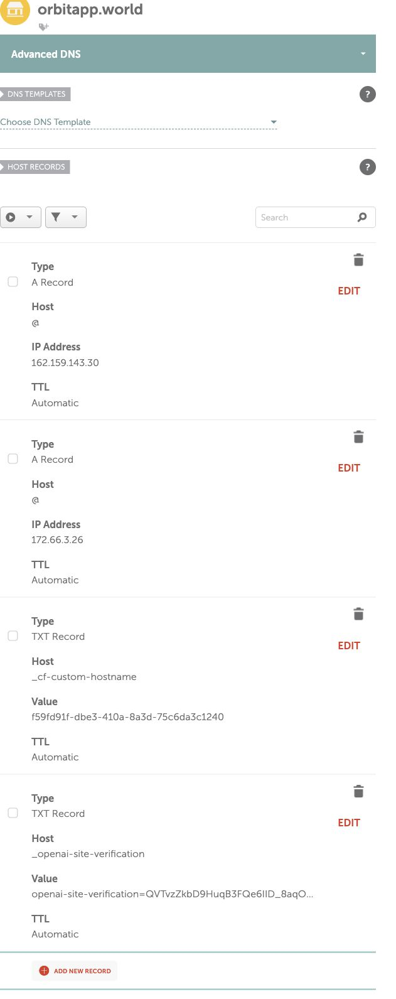

# orbitapp.world — Namecheap DNS handoff

Status checked October 11, 2026: [orbitapp.world](https://orbitapp.world/) is live. The founder signed into Namecheap and all four records below were saved and confirmed after reloading Advanced DNS. Hosting reports the domain, provider and TLS **active**; homepage, privacy, terms and support each returned HTTP 200 over HTTPS without bypassing certificate validation. Earlier pending-TLS/404 propagation states have resolved. The same site also remains published at [ORBIT public alpha](https://orbit-alpha-launch.funapple4.chatgpt.site).

The conflicting apex URL Redirect `@ → http://www.orbitapp.world/` was replaced with the first A record. The default `www → parkingpage.namecheap.com.` parking CNAME was also absent after saving/reloading; no mail settings, nameservers, DNSSEC or other domains were changed. Those original parking records are recoverable by re-adding the exact values, but would point visitors away from ORBIT. `www.orbitapp.world` is not configured as an ORBIT hostname in this pass.



## Add these four records

In Namecheap: **Domain List → orbitapp.world → Manage → Advanced DNS → Host Records → Add New Record**. Confirm the exact domain before saving. Use **Automatic** TTL. The Host field is a relative name, not the entire domain.

| Type       | Host in Namecheap           | Value                                                                  |
| ---------- | --------------------------- | ---------------------------------------------------------------------- |
| A Record   | `@`                         | `162.159.143.30`                                                       |
| A Record   | `@`                         | `172.66.3.26`                                                          |
| TXT Record | `_openai-site-verification` | `openai-site-verification=QVTvzZkbD9HuqB3FQe6IID_8aqOeFnT_AiUKkYsBVgU` |
| TXT Record | `_cf-custom-hostname`       | `f59fd91f-dbe3-410a-8a3d-75c6da3c1240`                                 |

These TXT values are public domain-verification records, not API keys. Save all changes and verify that all four rows remain after reloading.

The hosting service also supplies `custom-domains.chatgpt.site.` as its CNAME target. The two A records above are the supplied apex configuration; do not put an ordinary CNAME at `@` alongside them.

Preserve unrelated MX, SPF, DKIM, DMARC, other TXT records and subdomains. Inspect any conflicting apex parking A/AAAA, ALIAS or URL Redirect records before changing them. Do not reset the entire DNS zone. `www.orbitapp.world` is not attached in this pass; do not assume adding a `www` CNAME will make its certificate work.

### If Advanced DNS has no editable Host Records

Check **Domain → Nameservers**. Namecheap's Advanced DNS manages BasicDNS, FreeDNS and PremiumDNS. With custom nameservers, edit the records at the actual DNS provider instead. With Namecheap hosting nameservers, use the hosting DNS zone. Do not change nameservers blindly: that can break existing mail and other services.

## Verify, rather than assume

After records propagate:

```sh
dig orbitapp.world A
dig _openai-site-verification.orbitapp.world TXT
dig _cf-custom-hostname.orbitapp.world TXT
curl -I https://orbitapp.world/
curl -I https://orbitapp.world/privacy/
curl -I https://orbitapp.world/terms/
curl -I https://orbitapp.world/support/
```

The authoritative record values must match, the hosting domain must become active with ready TLS, and each HTTPS page must load without a certificate warning. No purchase or DNS attachment alone proves this.

Google Branding URLs after verification:

- Homepage: `https://orbitapp.world/`
- Privacy: `https://orbitapp.world/privacy/`
- Terms: `https://orbitapp.world/terms/`
- Support: `https://orbitapp.world/support/`
- Authorized domain: `orbitapp.world`

The founder supplied the support contact now configured in the landing page; real mailbox receipt and response coverage still need verification. There are no actual TestFlight/APK links. Set those only after they exist and are verified. `api.orbitapp.world` is a separate future Railway API domain: **do not point it at the landing-page A records**. Railway will supply its own record after the API is deployed.

## Hosting identity and future edits

- Site: `appgprj_6acb78843eb08191807df16170efa56c`
- Custom domain: `appgdom_6acb80fedf2c8191b33edc0e977477eb`
- Source of truth in this repository: `apps/landing/`
- Build: `pnpm build:landing`
- Public release configuration: `apps/landing/release-config.json`

Keep the same site and domain identities for updates. Build the static directory, push/package through the Sites workflow, save that exact source SHA and archive as a new version, and publish it. Never write the temporary repository credential into Git, an environment file, terminal history or documentation.

Primary instructions: [Namecheap host records](https://www.namecheap.com/support/knowledgebase/article.aspx/434/2237/how-do-i-set-up-host-records-for-a-domain/) and [Namecheap TXT records](https://www.namecheap.com/support/knowledgebase/article.aspx/317/2237/how-do-i-add-txtspfdkimdmarc-records-for-my-domain/).
