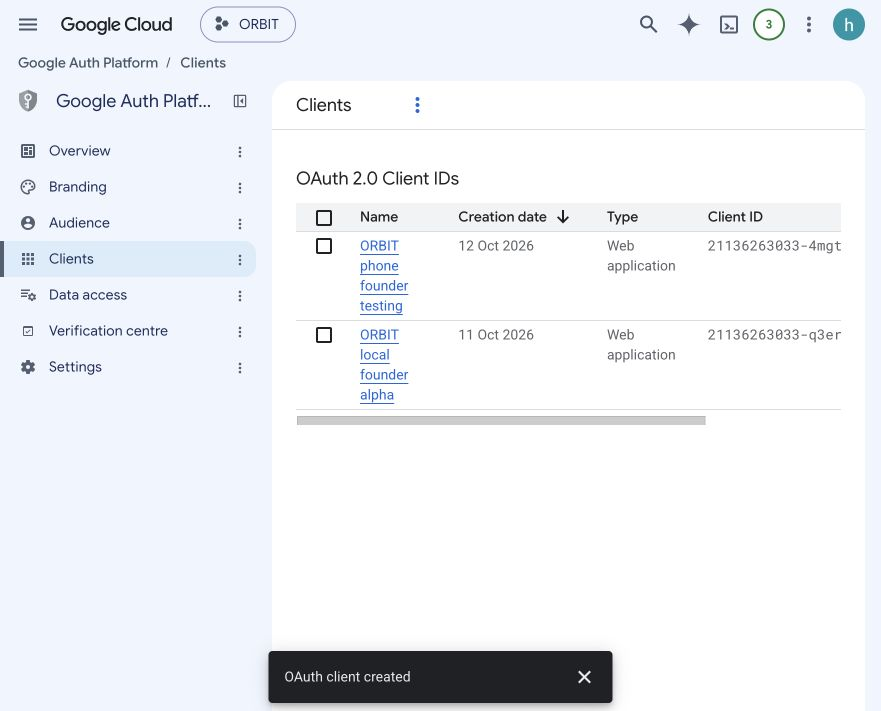
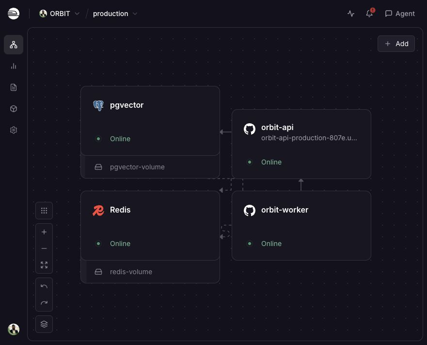
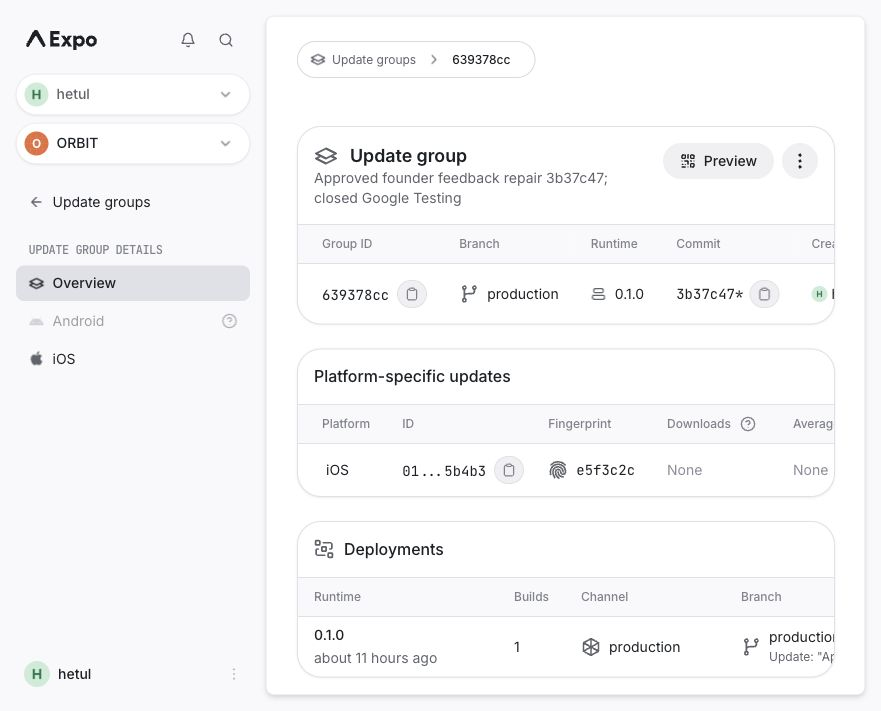
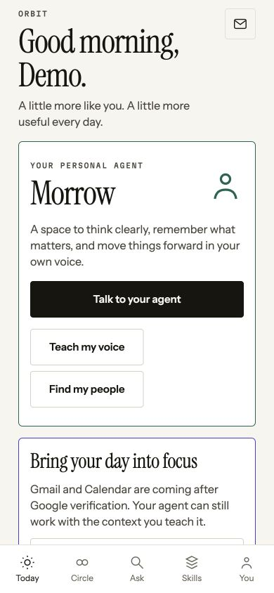
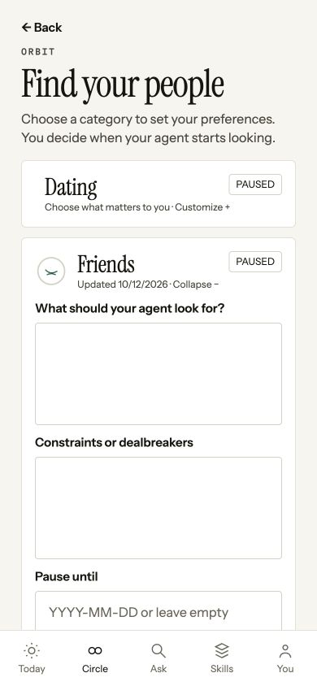
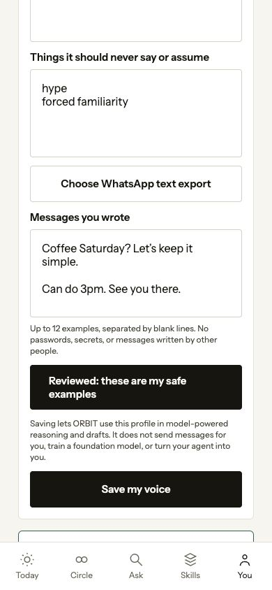

# ORBIT: founder phone feedback, deployed repairs and launch handoff

Released follow-on sprint, October 12, 13:25 Chicago: approved **74cea03** is live on API/worker; additive migration 17 applied. Matching iOS-only conversation/inbox update **9b4778f6** is published, manifest/served artifact hash verified. Latest suite: 194 passed, zero failures/skips. Native new-screen acceptance and real bounded Gmail completion remain pending; public signup/staffing remain closed and Google stays Testing. [Detailed current sprint/release report](GMAIL_SYNC_CHAT_20261012.md) supersedes the earlier local-only, expired-key and pending-consent checkpoints below.

Superseding checkpoint, October 12, 13:05 Chicago: founder confirmed Google consent and partial Gmail import, then successful native My agent replies after scoped key replacement. The old form UI is still installed. New conversation UI, categorized inbox and durable resumable Google sync pass a **194-test** isolated suite and root lint/typecheck, but are not yet deployed/published. Migration 17 is local only; safety/signup gates remain closed and Google stays Testing. [Detailed follow-on sprint report](GMAIL_SYNC_CHAT_20261012.md) supersedes the expired-key/pending-consent statements below while preserving the earlier repair's evidence.

Evidence checkpoint: October 12, 2026, 11:45 Chicago. This report supersedes older statements that the founder has not installed ORBIT or that production Google is wholly disabled. It does not rewrite older test results or mark unfinished work complete.

## 1. Outcome and honest readiness

The founder installed TestFlight **ORBIT: Private Companion 0.1.0 (1)**. Its initial startup crash was diagnosed from ORBIT-only iPhone logs, repaired, and the founder subsequently confirmed signing in and using the app. His next usability feedback produced repair commit **3b37c4796f457a232c1da036a4529c27f4895699**. That exact commit is now live on the existing API and worker. A matching inspected **iOS-only** update is published to the installed build's existing production channel/runtime **0.1.0**.

The latest full isolated regression run passes **181 tests, zero failures, zero skipped**. Root typecheck and lint pass. This is not a claim that every original feature is complete, every platform works, or real users find the product valuable.

The responsible release state is **closed founder phone testing**, not a public consumer launch. Founder consent and Gmail/Calendar synchronization on the newly enabled phone client still need a physical-device result. The current repair's native navigation, cold-launch session retention and native text picker also require phone retesting. A live authenticated personal-chat smoke test reached OpenRouter but failed because the **local root OpenRouter key is expired**. No successful live reply is claimed for this new endpoint. Whether the production key has the same problem has not been independently proved by this local test.

Public signups and staffing coverage remain closed. Google remains **External / Testing**, with two explicitly approved test emails, not verified. The founder chose to wait for actual Google verification before public store release. No public TestFlight link, landing-page APK release, App Review submission, Play submission, paid upgrade, new APNs permission or new billing service occurred in this repair.

## 2. Where to test

| Surface                | Address / build                                          | Meaning                                                                                                                                                                               |
| ---------------------- | -------------------------------------------------------- | ------------------------------------------------------------------------------------------------------------------------------------------------------------------------------------- |
| Founder iPhone         | Installed TestFlight 0.1.0 (1), production runtime 0.1.0 | Loads the newly published iOS update when online. Physical acceptance of this newest update remains pending.                                                                          |
| Normal local app       | http://localhost:8081                                    | Existing founder local environment; sign-in and saved private data stay separate from the synthetic QA environment. HTTP 200 checked this turn.                                       |
| Normal local API       | http://localhost:4100/ready                              | HTTP 200 and database ready checked this turn. Local-only Google client remains separate from the phone client.                                                                       |
| Latest synthetic QA UI | http://localhost:8090                                    | Real UI against isolated API/database, clearly fictional seeded users. The model is deliberately stubbed and Google disabled here. Do not mistake fixtures for real product outcomes. |
| Synthetic QA API       | http://localhost:4150                                    | Private local test services; source-backed group/voice writes were exercised here, not in founder/production data.                                                                    |
| Live API readiness     | https://orbit-api-production-807e.up.railway.app/ready   | HTTP 200, database ready. Readiness proves service/database health, not every provider flow.                                                                                          |
| Owned-domain landing   | https://orbitapp.world/                                  | Existing HTTPS homepage, privacy, terms and support. Download states remain honestly unavailable until actual approved public links exist.                                            |

The local processes are development processes, not permanent hosting. They stop if the Mac/session stops. Existing restart instructions remain in [RUNBOOK.md](RUNBOOK.md).

## 3. Every founder feedback item and what changed

| Feedback                                        | Current implementation                                                                                                                                                                                                     | Proof / remaining limitation                                                                                                                                                                                                                |
| ----------------------------------------------- | -------------------------------------------------------------------------------------------------------------------------------------------------------------------------------------------------------------------------- | ------------------------------------------------------------------------------------------------------------------------------------------------------------------------------------------------------------------------------------------- |
| App opens and immediately crashes               | Earlier native startup fix restricts browser `window.location` access to web; included in this new iOS bundle.                                                                                                             | Founder physically confirmed the earlier corrected app launches/signs in. New update includes the guard; newest phone retest still pending. Original embedded binaries still require rebuilds for clean/offline-first installs.             |
| Sentry notification that something failed       | Investigated only ORBIT projects. Old API CORS issue had 72 events; another issue was a controlled route-not-found response. Disallowed browser origins now receive controlled 403 rather than a thrown generic exception. | API tests cover disallowed origin and native/no-origin requests. This does not prove which alert the founder saw or that no other errors exist. Sentry stays enabled.                                                                       |
| Separate sign up / sign in                      | One screen now exposes explicit modes. Signup collects name/DOB; existing-user sign-in only asks email/code. Server verifies OTP before revealing account existence.                                                       | API/UI regressions pass. Signup still enforces adulthood, admission gates and the account cap. It is not a new password-auth system.                                                                                                        |
| Not a new code every time                       | Keychain-backed saved tokens remain; concurrent access-token expiry now shares one refresh-token rotation. Temporary outages preserve the session rather than signing the user out.                                        | Refresh-race/outage/account-change tests and mocked native SecureStore rehydration pass. Actual iPhone cold launch/background/expiry must still be tested. A revoked/expired session or explicit signout still requires email verification. |
| Cannot find Gmail after first prompt            | Permanent Today Gmail/Calendar card; permanent You → Connected accounts entry. Read-only and testing/unavailable states are explicit.                                                                                      | Actual browser navigation verified; phone OAuth client/API credentials configured. Actual founder consent, refresh and sync pending.                                                                                                        |
| Catch has no route back                         | Auxiliary pages have a top Back control with history and a safe section fallback for direct links.                                                                                                                         | Catch/back browser run and navigation tests pass.                                                                                                                                                                                           |
| Bottom controls disappear on Catch/intents/etc. | Main navigation moved outside the root stack. Today, Circle, Ask, Skills and You remain available on signed-in auxiliary screens, without duplicate tab bars.                                                              | Actual phone-size browser Catch/finder/groups/connections/voice runs and tests. Native safe-area/keyboard testing pending.                                                                                                                  |
| Finder page too long                            | All categories initially collapsed; opening Friends, Roommates, Dating, etc. expands only that category. Existing saved controls remain.                                                                                   | UI regression and actual Friends browser run. Invalid pause dates show a validation error rather than crash or silently normalize an impossible date.                                                                                       |
| Groups can only be joined                       | Added explicit private-group creation, club/class/lab selection, owner membership and owner-only join-code display/copy.                                                                                                   | Real API/database and browser creation, join/member privacy tests. Maximum five active owned groups, creation limit five/hour. No public group directory or group deletion/member-management UI was added.                                  |
| Today looks dull/empty                          | Time-of-day/name greeting, real agent name, Talk / Teach / Find actions, permanent inbox connection state, honest useful empty states.                                                                                     | Screenshot and actual rendered UI. No fake inbox results, users or efficacy statistics added. Design quality and retention still need real usability measurement.                                                                           |
| Remove ORVIN/developer explanations from users  | Removed ORVIN-backbone and unnecessary developer/cost/seed copy from touched product surfaces; reused the existing icon system for the hero/navigation.                                                                    | Source/UI review. Consent, read-only limits and genuine provider-unavailable messages remain because they affect user decisions.                                                                                                            |
| Agent should know and sound like its user       | Added editable owner voice/boundaries/examples and consented memory-context personal chat. Existing interview and memory correction/forget remain.                                                                         | Deterministic UI/API ownership/consent/bounds tests pass. No proof of faithful representation, AGI or useful live personal reply yet.                                                                                                       |
| Read iPhone/WhatsApp messages                   | Added optional user-selected WhatsApp **text export** import and manual paste of texts the user wrote. Parsing/author selection occur locally.                                                                             | Actual synthetic browser picker, author filtering, common-contact masking, reviewed save and reload persistence pass. Native picker not yet physically tested. No automatic iPhone Messages/personal WhatsApp inbox connector exists.       |

## 4. New and changed controls: exact behavior

### Navigation, Today and You

**Today / Circle / Ask / Skills / You** navigate to their main section. Auxiliary Catch pages highlight Today; finder/introduction/exchange/screening highlight Circle; groups/watchers/skill/run highlight Skills; settings/connections/memory/voice/safety/admin highlight You. **Back** uses available navigation history; direct links without history return to the corresponding section. The bar is intentionally absent from authentication/onboarding gates.

Today's **Talk to your agent** opens personal Ask; **Teach my voice** opens the writing/profile review; **Find my people** opens collapsed finder categories. The permanent Gmail/Calendar entry opens Connected accounts. You provides **Connected accounts** and **Teach your agent** alongside existing memory/settings/safety tools. These do not silently grant provider access.

### Authentication

**Sign up** selects new-account identity collection; **Sign in** selects existing-account mode. **Send code / resend / verify** still use real delivered OTPs in production. No permanent seed code, on-screen production code or developer bypass was introduced. A valid code for a nonexistent account in sign-in mode returns `ACCOUNT_NOT_FOUND`; an incomplete new-account identity returns validation failure. Account existence is checked only after code verification and checked again within the registration transaction.

Email OTP is passwordless authentication, not an attempt to make the user repeat signup. Saved native tokens should resume the session. Server refresh rotation remains enforced; single-flight client refresh prevents several simultaneous expired requests from consuming the same token independently. A refresh 503/network outage leaves the saved session intact; an actual refresh 401 signs out. A response from an old account/session cannot overwrite a newly selected one.

ORBIT login and **Google reconnection** are different events. Google's Testing grant can require reconnection after seven days; that does not require redoing ORBIT onboarding or acquiring a fresh ORBIT email code when the ORBIT session remains valid. Google Testing rules are documented in Google's [Audience guidance](https://support.google.com/cloud/answer/15549945).

### Connection finder

Each **category preferences** heading is an accessible disclosure with expanded state. Opening a second category collapses the first. Existing **activation**, **Save details**, desired qualities, autonomy, pauses and evidence controls persist. Invalid or impossible pause dates are rejected before a write. Collapsing is only a UI change: it does not disable an active saved intent or create matches.

### Groups

**Create a group** opens a form without writing anything. **Club / Class / Lab** chooses kind. **Create private group** validates and submits; the API creates the private group and OWNER membership atomically. **Join code** entry and **Join group** retain the existing code-based membership path. **Copy join code** is available to the owner; ordinary members do not receive the owner code in list responses. The group shelf remains role-aware.

Codes contain 10 cryptographically random bytes encoded as 20 uppercase hex characters. The server serializes creation per owner and limits active ownership to five. The concurrent maximum-five boundary was reviewed in source but not separately stress-tested this turn. People who receive a private code can join: do not publish it casually. No email/SMS invitation, arbitrary member promotion/removal, code rotation or public directory was implemented in this feedback repair.

### Teach your agent

**How should your agent sound?** edits sentence style; **Things it should never say or assume** edits avoid guidance; **Messages you wrote** edits examples. The reviewed profile rehydrates from the owner's API record; a background query refetch does not overwrite unsaved edits.

**Choose WhatsApp text export** opens the OS/browser file picker. Only an already-unzipped `.txt` smaller than 100 KB is accepted; media/ZIP archives are not parsed. **Use only [participant]'s messages** retains that chosen author's latest twelve examples, each at most 1,000 characters. Common email addresses, HTTP links and phone-like numbers are masked. This is **not comprehensive anonymization**: names, addresses, secrets, health information or unusual identifiers can remain. The user must review/edit them.

The entire original export is not posted to ORBIT. Only explicitly selected and reviewed examples plus chosen profile fields are saved by **Save my voice**. **I reviewed these examples and they are mine** is required in the UI and server boundary; editing resets review. Temporary native picker copies are deleted only when inside the app cache; the original selected file is not deleted. Save/reload was verified with fictional examples against the isolated database. Native cleanup/picker behavior still needs a physical-device test.

This is an opt-in way to supply writing evidence, not automatic personal inbox surveillance. WhatsApp documents a manual [chat export flow](https://faq.whatsapp.com/1180414079177245/?cms_platform=iphone&locale=en_US); iOS apps are constrained by platform isolation and entitlements, described in Apple's [runtime security guidance](https://support.apple.com/guide/security/security-of-runtime-process-sec15bfe098e/web). ORBIT has no supported automatic bulk consumer iMessage/personal WhatsApp connector. No new native permission or entitlement was granted.

### Personal Ask versus Mail & Calendar

**My agent** is the default Ask mode. The user writes a message and explicitly selects **Allow my context for this chat** before **Send to my agent** enables. The disclosure covers saved memories, reviewed voice, this message and recent turns being sent to the configured reasoning provider. No Google connection is necessary for this mode.

The server supplies the latest forty nondeleted/nonsuperseded owner memory facts (each truncated to 1,000 characters), reviewed voice, up to eight recent turns and the current message. Input is bounded at 2,000 characters/turn; output is bounded to 450 tokens. It uses the existing conversation model route and transactionally enforced budget ledger. This is contextual inference, not foundation-model training. It has no tools, cannot send a message, cannot change memories, cannot promise access to connected inboxes and is instructed to distinguish known facts from unknowns. Those prompt boundaries are not a formal guarantee against all model mistakes or prompt injection.

Successful replies appear as a local conversation. **Clear this chat** clears displayed turns and resets consent. Turns are not automatically converted to memory or persisted as an ORBIT chat transcript. Only recent turns in the current UI are sent; activity records memory count, not raw prompt or writing examples. These writes are not silently queued/cached for offline execution.

**Mail & Calendar** retains the separate source-grounded life-query/Catch flow. It searches connected synced sources; it is not magically granted by personal-chat consent. Copying a draft does not send email; Gmail/Calendar scopes are read-only.

In isolated stub configuration, the actual UI shows an unavailable notice instead of inventing a model reply. In the live local smoke, the provider reported **401 API key expired**; the current API wraps that failure as a generic internal-error response. A more specific provider-auth failure message is a known follow-up; it has not been secretly deployed beyond the approved commit.

## 5. API changes in this repair

The complete existing route inventory is in [PUBLIC_ALPHA_VERIFICATION.md, API surface](PUBLIC_ALPHA_VERIFICATION.md#4-complete-current-api-surface) and [API.md](API.md). These are the new/changed boundaries, not an assertion that every route was individually manually exercised again.

| Method and route                                       | Request / authorization                                                        | Behavior and limits                                                                                                                                                                                                                                                    |
| ------------------------------------------------------ | ------------------------------------------------------------------------------ | ---------------------------------------------------------------------------------------------------------------------------------------------------------------------------------------------------------------------------------------------------------------------- |
| `POST /v1/auth/otp/verify`                             | Valid email/code plus optional `mode: sign_in                                  | sign_up`; new account still needs valid name/DOB                                                                                                                                                                                                                       | Existing-user sign-in no longer needs new identity details. Post-proof account checks, adult gate, serialized hard cap and admission controls remain. Older clients remain compatible. |
| `POST /v1/auth/refresh`                                | Existing refresh token                                                         | Server rotation unchanged. Client now deduplicates concurrent refresh and preserves sessions on temporary failure.                                                                                                                                                     |
| `GET /v1/groups`                                       | Current authenticated user                                                     | Active memberships only; returns kind, name, visibility, active member count and role. Join code only for OWNER.                                                                                                                                                       |
| **`POST /v1/groups`**                                  | Authenticated; `{name, kind}`                                                  | Name 2–80 chars; `club/class/lab`; always private; transactional owner creation; 201 on success; five/hour and five active owned groups. Logs creation receipt.                                                                                                        |
| `POST /v1/groups/join`                                 | Authenticated; existing code                                                   | Existing membership flow remains; real API tests cover created group join and non-owner code privacy.                                                                                                                                                                  |
| `GET /v1/agent`                                        | Current owner                                                                  | Existing profile route supplies the voice editor. No other user's voice/memories included.                                                                                                                                                                             |
| `PATCH /v1/agent`                                      | Current owner; `voiceProfile`, **`confirmVoiceProfile: true`** for changes     | Explicit confirmation enforced server-side; field/example schema bounds and existing owner protection apply. No raw export attached.                                                                                                                                   |
| **`POST /v1/agent/chat`**                              | Current owner; `message`, **`contextConsent: true`**, bounded optional history | Uses owner context and existing ModelRouter budget. No external actions/memory mutation. Stub gives 503 `PERSONAL_AGENT_UNAVAILABLE`; cap gives controlled 429; current provider-auth failure is generic 500. Returns answer/provider/model/memoryCount after success. |
| Existing Google connection/status/sync/callback routes | Auth for owner operations; callback requires existing single-use OAuth state   | Enabled only under approved Testing allowlist using a separate production-callback client. No new scopes, sending or event editing.                                                                                                                                    |
| Existing CORS boundary                                 | Browser Origin checked; native requests may have no Origin                     | Disallowed browser Origin gets controlled 403 `ORIGIN_NOT_ALLOWED`; allowed/native requests retain normal API behavior. No permissive wildcard added.                                                                                                                  |

The deployed unauthenticated new-chat probe returned **401 AUTH_REQUIRED**; no owner token was forged or copied for production tests. No database migration was added in this repair; the existing sixteen production migrations remain applied. Production was not seeded.

## 6. Google project and production settings actually completed

The dedicated project is **ORBIT / orbit-511108**, not another application's project. Its console confirms External/Testing and only the two approved test accounts. Declared data scopes remain **Gmail read-only (restricted)** and **Calendar read-only (sensitive)**. APIs/consent/local founder client existed from earlier approved setup.

Created the separate **ORBIT phone founder testing** Web OAuth client with only:

`https://orbit-api-production-807e.up.railway.app/v1/connections/gmail/callback`

No JavaScript origin, local callback reuse or other-app credentials were introduced. Generated values were saved only in ignored private local files and ORBIT API settings; worker settings reference that API's two values. The local `.env` Google client was not replaced. Google credentials are server secrets, never mobile bundle variables.

API/worker now use `GMAIL_INTEGRATION_ENABLED=true`, `GOOGLE_CLOUD_PROJECT_ID=orbit-511108`, the above callback, the approved two-email allowlist and `GOOGLE_OAUTH_VERIFICATION_STATUS=testing`. These flags do **not** constitute Google approval or user consent. The primary founder's operator bootstrap remains the only production signup exception; the second Google tester is not automatically a new public ORBIT signup exception.

Owned-domain verification, review evidence/video, restricted-Gmail requirements and applicable security assessment remain unfinished. Under-100 enrollment is not an exemption for public restricted-Gmail access. See Google's [restricted-scope production requirements](https://developers.google.com/identity/protocols/oauth2/production-readiness/restricted-scope-verification). No completion date or assessment price is promised.

## 7. Deployment, update and monitoring evidence

| Item                  | Verified evidence                                                                                                                               |
| --------------------- | ----------------------------------------------------------------------------------------------------------------------------------------------- |
| API source            | Full repair commit `3b37c4796f457a232c1da036a4529c27f4895699`; deployment `194e9573-541c-4f0b-9e08-ef5e74bb63fb` SUCCESS                        |
| Worker source         | Same full commit; deployment `5466fab3-052c-4778-a8c3-e362347118c5` SUCCESS                                                                     |
| Applied state         | Both services live; no pending staged patch after deployment                                                                                    |
| API/worker resources  | Each single replica, us-west2, 0.25 CPU / 500,000,000 bytes RAM; existing limits unchanged                                                      |
| Private services      | Worker, Postgres/pgvector and Redis remain private; two existing persistent volumes; API only has public HTTPS                                  |
| Model budget          | 10¢/user/day; shared 50¢/day; worker model allowance zero; no cap increase                                                                      |
| Admission             | `/v1/alpha/status`: capacity 100, acceptingNewAccounts false, waitlist available, reason safety_coverage                                        |
| iOS update group      | [639378cc-ae8e-4518-bbc3-b4c4d3262219](https://expo.dev/accounts/hetul/projects/orbit/updates/639378cc-ae8e-4518-bbc3-b4c4d3262219)             |
| iOS update ID         | `01a130f2-99df-7c48-abf4-5b4b34243a76`; production branch/channel, runtime 0.1.0, iOS only                                                      |
| Hermes launch bundle  | 5,217,588 bytes; SHA-256 `16d04087055fa00be96f369b4e78f7867193f24f3390c92a74dfa1368d8a2837`                                                     |
| Delivery verification | October 12 16:37:54 UTC: manifest 200; launch asset 200; exact update ID/runtime; downloaded binary SHA matches the prepared inspected artifact |
| Sentry source map     | Uploaded to gsin-bb/orbit-mobile; artifact bundle `a107d979-ffe3-54ff-a0fc-5185dc680d22`; debug ID `073a97b5-24c8-4e7a-a40d-173d80b9b8b4`       |
| Sentry releases       | API/worker `orbit@0.1.0+3b37c47`; monitoring/scrubbing remain enabled; no unrelated app touched                                                 |

Matching source-map upload is verified, not symbolication of a new real crash. The exporter inspected all 44 output files against actual private credential values with no matches and checked inclusion of startup guard/new screens. This is targeted credential/source inspection, not a complete formal security audit. Expo displayed a dirty-worktree asterisk while evidence/web-only work was ongoing; delivery verification is against the prepared inspected iOS artifact, not an uninspected later rebundle. The later **web-only** file-picker correction was not added to the already exported native bundle; the native picker path is unchanged.

The update protocol check followed Expo's manifest/asset mechanism, including asset-specific extension headers; see the official [Expo Updates protocol](https://docs.expo.dev/technical-specs/expo-updates-1/). It proves the bytes are downloadable, not that the founder's phone has loaded them.

## 8. Verification: what actually ran

The full suite used two newly created local disposable databases, **orbit_test_founder_20261012_747657** and **orbit_test_founder_alpha_20261012_747657**. Both received sixteen migrations; only the main isolated database received forty clearly synthetic seed users. The production and primary founder databases were not wiped/reseeded. All model tests in this suite use controlled providers, not billed real-model answers.

| Suite                      | Passing tests |
| -------------------------- | ------------: |
| Shared schemas             |             2 |
| Model routing/budgets      |             9 |
| Agent engine               |            17 |
| Worker                     |            13 |
| API/database integration   |            43 |
| Mobile/UI                  |            75 |
| Root configuration/scripts |            22 |
| **Total**                  |       **181** |

Zero failures/skips. DB/UI packages have no standalone test files; successful no-test tasks are not counted as coverage. Typecheck/lint pass across eight packages; targeted formatting checks apply to changed text/source. Passing tests do not establish a percentage of all requirements covered.

New regression evidence includes post-OTP signin/signup identity handling, single-flight refresh, preserving sessions during outages, stale-account guards, mocked Keychain restoration, persistent navigation/back fallback, collapsed categories, invalid dates, private-group creation/member-code privacy, reviewed owner voice edits, browser-vs-native file access, filtered WhatsApp examples, chat consent/owner-context/bounds/stub unavailability and excluding sensitive new writes from offline queue/cache. Existing safety/admission/redaction/export/deletion tests also ran.

Actual browser runs at 390×844 exercised returning synthetic login, Today, Catch and back, persistent tabs, Friends expansion, Groups via Circle, real private-group creation, You → Connected accounts, You → Teach your agent, a real synthetic `.txt` file chooser, author filtering, common-contact masking, edit/review/save and fresh-page profile persistence. Personal chat in the deliberately stubbed preview shows an honest unavailable error and retains the input/navigation.

### Live model smoke: failed, not hidden

An initial shared-fixture smoke hit the one-cent **test-only** cap because its database already held test reservations. It was not called a provider result, and production caps were not changed. A subsequent fresh empty local database created a fictional owner/agent, reviewed voice and one fictional memory, then called the actual authenticated personal-chat endpoint with the root OpenRouter key. OpenRouter rejected it with **401 API key expired**; API returned generic internal error. No founder messages/data were sent in this diagnostic. No successful reply or measured new-chat efficacy is claimed.

The founder has been asked to replace `OPENROUTER_API_KEY` privately in the ignored root `.env`, not in chat, and separately approve its ORBIT-only API/worker transfer. That response is still pending at this checkpoint. Repeatedly retrying an expired key, fabricating a stub response or silently increasing budgets would not complete this test.

## 9. Original product promises that this repair does not finish

The original document contained a broad product, not just this feedback list. The [current feature/button/API inventory](PUBLIC_ALPHA_VERIFICATION.md), [Pass 5 evidence](PASS5_VERIFICATION.md) and historical [31-feature specification audit](BUILD_AND_LAUNCH_AUDIT.md) remain the detailed baseline. Older dates/percentages there are historical judgments, not current readiness scores. This repair adds private group creation, reviewed writing import and bounded personal chat; it does not erase these gaps:

- **Faithful user representation:** Six interview answers and examples are a starter profile. Adaptive interview labeling, completion/matching readiness and validation remain [onboarding issue #36](https://github.com/Hetul803/ORBIT/issues/36). No calibrated confidence, user-fidelity benchmark or reliable independent representation has been demonstrated. The agent must ask when it does not know; it is not the user and not AGI.
- **Useful matching at tiny populations:** Intent/candidate/reranking/conversation/reveal/outcome pipelines exist, but embeddings/provider configuration, actual population and measured usefulness matter. Worker model spend is currently zero. Do not promise live recurring agent introductions from this deployment. A one-user product can still offer owned memory, writing review, source-backed Catch after consent, public-page watchers and approved personal chat after a valid model key; that value has not been established by retention data.
- **Outcome learning:** Stored ratings/private outcomes are not proof of a trained reranker or self-improving representative. No arbitrary learned skill autonomously runs code or new external tools.
- **External execution:** Google is read-only. No Gmail send/event editing, general Microsoft/IMAP connector, automatic iMessage/WhatsApp inbox, payments or unrestricted autonomous commitments were added.
- **Groups:** New creation supports private membership/shelf value, not project ingestion/coordinated work, full role management or a group network flywheel.
- **Native distribution:** Original build-1 IPA/APK retain the old startup bug in their embedded JS. The OTA helps existing online iOS installs, not a fresh offline launch guarantee. Corrected native rebuilds and device QA remain necessary. Android APK has not received this iOS-only update and no physical Android proof exists.
- **Safety operations:** Server report suppression, permanent instant bidirectional block, email/push outbox, hard account cap and separate reconnect measurements are implemented/tested. Real operator push/APNs delivery, two-person device drill and staffed 15-minute acknowledgment/60-minute first-action commitment remain unproved. Operator configuration is not staffing. Keep admission closed; [moderation runbook](MODERATION_RUNBOOK.md) remains applicable.
- **Google public release:** Testing allowlist is not verification. Domain/review/demo/provider-data-use and applicable restricted-scope assessment remain, including costs outside ordinary hosting.
- **Store/legal readiness:** Play identity review/phone/real Android-device verification must clear; external TestFlight/App Review/Play submission, actual public links, privacy/data declarations and applicable legal/account-deletion requirements remain. No claim that a static landing page alone meets every store requirement.
- **UI quality/accessibility:** New browser-size flows were exercised; native keyboard, safe areas, screen reader, large-text and full offline/deep-link combinations still require acceptance. Styling is not a retention or billion-dollar-company guarantee.

The ORVIN-inspired reusable skill versions, provenance/receipts, dependency/validation and owner feedback structure remain architectural foundations. Merely hiding their internal name or adding a chat box does not create an uncopiable moat. Differentiation needs consented longitudinal data, measurable trust/usefulness and repeatable task outcomes; none should be exaggerated to users or investors.

## 10. Budget and private credential handling

No plan upgrade or new paid service was created. Existing API/worker resource limits, free Expo/Resend/Sentry settings and model caps were retained. A 50¢ shared daily model cap permits roughly **$15–$15.50/month** of modeled allowance across all users, not $15 per user. Actual bills, networking/storage and provider pricing must still be monitored; a cost reservation is not an invoice. The $100/month target is a ceiling, not proof that 100 active users receive unlimited model work. Google assessment, staffing/legal work and enrollment costs are not magically included in hosting. See [budgeted deployment](BUDGETED_DEPLOYMENT.md) and [provider cost assumptions](PROVIDER_SETUP_AND_COSTS.md) for the earlier allocation and caveats.

Do not place server keys in any `EXPO_PUBLIC_*` variable. The new Google credential JSON is ignored, with directory 0700/file 0600; root/provider files stay ignored. Mobile exports contain only public URLs, public Expo project ID and public Sentry DSN. No private Google/OpenRouter/Resend/Sentry upload credential was printed in this report or shipped in the inspected artifact. Targeted scans are not substitutes for secret rotation/security review.

## 11. Founder acceptance checklist and next gates

1. Open installed ORBIT online for about ten seconds, force-close and reopen once. Confirm the new Today hero, five bottom tabs, Catch Back and collapsed finder appear. Do not reinstall just to obtain the update unless troubleshooting specifically requires it.
2. In **You → Connected accounts → Connect Google**, choose an approved test mailbox and personally review Google's read-only consent. Report the destination screen/error, not codes/messages. Verify connection state, sync completion, source citations and disconnect/refresh behavior on device.
3. Replace the expired local OpenRouter key privately and authorize the narrow production transfer if desired. Then run the real authenticated chat smoke once within the existing budget and test factual/voice alignment, uncertainty and no-action boundaries. Until then, new personal chat is not verified end to end.
4. Test iPhone cold-launch/background session persistence, keyboard/safe areas, voice text-file selection/review/save, groups and offline error recovery. Then do the separate two-person safety/push/consent drill with staffing in place.
5. Rebuild corrected embedded native binaries before wider installation; complete Android physical checks and platform prerequisites. Keep public store submissions waiting for actual Google approval as requested.
6. Only open public admission after verification/privacy/store/safety/device gates pass, with the server's 100-account cap and honest waitlist still enforced. Publish actual approved TestFlight/APK URLs on orbitapp.world; never substitute a nonexistent download button or claim verification manually.

**Bottom line:** the approved repair and iOS delivery are complete and verified at the infrastructure/artifact level. Newest founder-phone acceptance, a valid live-model response, Google consent/sync and public-launch prerequisites are not complete. The product is a useful, testable closed alpha with meaningful implementation—not a verified public release or AGI.
