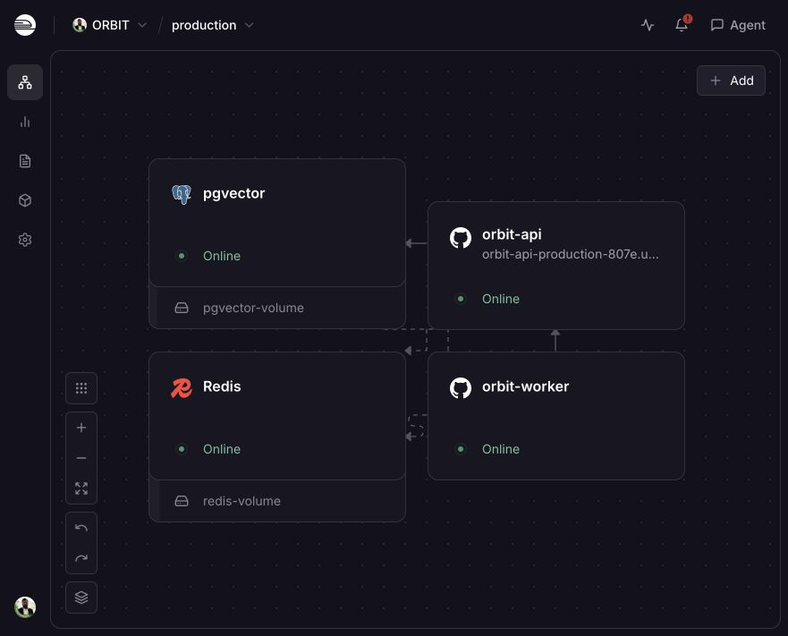
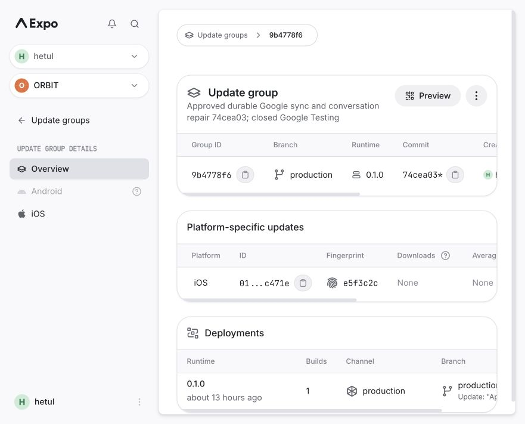
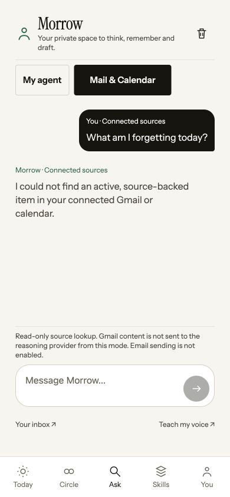

# ORBIT: durable Google sync and conversational-agent update

Evidence checkpoint: October 12, 2026, 13:25 Chicago. This report updates, rather than erases, the historical [founder feedback inventory](FOUNDER_FEEDBACK_20261012.md) and [original build audit](BUILD_AND_LAUNCH_AUDIT.md).

## Outcome and release state

The founder has confirmed both a real Google connection on the installed iPhone and successful **My agent** replies after the approved OpenRouter key replacement. The first Gmail import failed after approximately 200 messages; its successful completion is **not** claimed. His last phone result still showed the old chat form; acceptance of this newest update remains pending.

This sprint implements a real conversation screen, a categorized read-only inbox and server-owned, resumable Google synchronization. The founder approved the exact release: **74cea03407ab18380f162d14ee464ca9b31d027a is now deployed to the existing API/worker, production migration 17 applied, and its inspected matching iOS-only update is published to the installed TestFlight build's production channel/runtime 0.1.0.** Actual manifest and delivered bundle SHA-256 match the prepared artifact. The phone must download/load the update; its new UI and real-mailbox completion are not yet physically confirmed.

The latest fresh isolated regression suite passes **194 tests, zero failures and zero skipped**. Root lint and typecheck pass. No production/founder database was seeded or wiped. This is evidence of the named automated checks, not a claim that every original requirement or native-device interaction works.

Public signup and moderation staffing gates remain closed. Google remains External/Testing, with only the two approved test emails. This is not Google verification, a public TestFlight link, an App Store/Play release, or permission to invite strangers.

## Approved release and delivery evidence

| Check                    | Actual result                                                                                                                                                                                                                       |
| ------------------------ | ----------------------------------------------------------------------------------------------------------------------------------------------------------------------------------------------------------------------------------- |
| Source                   | `74cea03407ab18380f162d14ee464ca9b31d027a`, pushed and pinned for API/worker; deployment metadata matches exactly.                                                                                                                  |
| API                      | `99707621-4426-40e1-9f53-426ebfb23ed1`, SUCCESS.                                                                                                                                                                                    |
| Worker                   | `6230a316-0018-42c1-8387-19d79fd2883e`, SUCCESS.                                                                                                                                                                                    |
| Migration                | Production pre-deploy log: 17 migrations found, `202610120017_durable_google_sync` applied, all migrations successfully applied. No seed or destructive SQL.                                                                        |
| Backend health           | All four services online, one running replica each; final one-hour status has zero current issues/failures and no pending work. Readiness HTTP 200/database ready.                                                                  |
| Protected routes         | `/v1/mail` and `/v1/connections/gmail/status` return controlled HTTP 401 without authentication; no email or tokens disclosed. This is an authorization check, not an authenticated founder-import test.                            |
| Admission                | HTTP 200, capacity 100, `acceptingNewAccounts:false`, `waitlistAvailable:true`, `reason:safety_coverage`.                                                                                                                           |
| iOS update group         | [9b4778f6-536d-42db-aef2-d25cec18ac6c](https://expo.dev/accounts/hetul/projects/orbit/updates/9b4778f6-536d-42db-aef2-d25cec18ac6c), iOS only, production runtime 0.1.0.                                                            |
| iOS update ID            | `01a1315c-2473-73ad-b677-c471ecea9f5e`. Production manifest and launch asset both returned HTTP 200 at 13:25 Chicago.                                                                                                               |
| Delivered bundle         | 5,229,000 bytes; SHA-256 `9e3ff34452001f673cf3f07a91dcc02e24da252611d433d0b5da337875d5b4ea`, identical to the inspected artifact.                                                                                                   |
| Source map               | Matching ORBIT mobile source map uploaded; debug ID `e35b4b44-cdf7-40b3-a4ce-e967089accdf`. API/worker release labels are `orbit@0.1.0+74cea03`. A source-map upload is not a passing physical crash test.                          |
| Bundle/privacy           | 44 exported files scanned against current private credentials; none found. Native startup guard, global sync observer, chat and inbox controls are present. Only public mobile endpoints/project ID/public Sentry DSN are injected. |
| Unchanged infrastructure | API/worker remain 0.25 CPU / 500 MB / one replica in us-west2. API alone is public; no worker domain/TCP proxy, no data-store exposure or new service/volume/plan.                                                                  |

Seven staged fields affected only the two source pins/redundant unchanged worker source fields and their Sentry release labels. No provider secret, Google grant/scope, resource limit, network setting or admission/staffing variable was changed. The existing dashboard route was used under the founder's deployment approval. During replacement an old API instance briefly appeared as CRASHED, then REMOVED; the final current status has no failures/issues. No new-build crash is claimed or concealed.

EAS displays `74cea03*` because the checkout includes untracked/excluded local evidence; tracked source was clean at publication. The independently inspected export, published update and downloaded SHA establish the actual artifact. This did not rebuild the embedded native IPA or publish Android.

Later recheck, October 12 at 23:19 Chicago: the same exact-source API/worker remain online, all four services have one running replica and zero issues/recent failures/pending operations; readiness returns 200 and public admission is still closed at capacity 100. A workstation DNS/connector failure during a preceding check was transient and resolved without changing network settings or redeploying. It was not evidence of an ORBIT server failure.





## What the new chat changes

The Ask section is now a conversation with the owner's named agent, rather than a growing question-and-answer form. Replies are rendered in a scrolling message list; **reply length never increases the input field**. The multiline composer at the bottom has a 42-point minimum and a 130-point maximum height. It clears when a request starts. Long answers remain selectable in the conversation.

| Control or state   | Exact behavior                                                                                                                                                                                                                                                |
| ------------------ | ------------------------------------------------------------------------------------------------------------------------------------------------------------------------------------------------------------------------------------------------------------- |
| Agent heading      | Loads the current owner's agent name; falls back to “Your agent” while loading.                                                                                                                                                                               |
| My agent           | Uses the existing authenticated `/v1/agent/chat` endpoint and current reviewed voice/memories. Requires explicit context consent.                                                                                                                             |
| Mail & Calendar    | Uses `/v1/life/ask` for source-backed lookup; shows available citations inline. This is a separate read-only lookup mode, not automatic access to all email through the personal-chat model.                                                                  |
| Prompt suggestions | Insert “Help me plan my week” or a draft-in-my-voice prompt into the composer. They do not send without a tap.                                                                                                                                                |
| Send arrow         | Adds the user bubble immediately, clears the composer and shows a thinking/source-checking indicator. Disabled during a request, for fewer than three trimmed characters, or without required personal-context consent. Input is limited to 2,000 characters. |
| Agent reply        | Appears as a separate message, not inside the input. No streaming-token animation is implemented; the pending indicator lasts until the full response arrives.                                                                                                |
| Source link        | Opens that source's existing Gmail/Calendar URL; failure shows a recoverable error. It does not send, archive or edit mail.                                                                                                                                   |
| Clear this chat    | Clears displayed turns, draft, error and context consent. Disabled during a request. Does not delete memories or connected sources.                                                                                                                           |
| Your inbox         | Opens the new categorized inbox. Back/main navigation remain available.                                                                                                                                                                                       |
| Teach my voice     | Opens the existing reviewed voice/boundaries/own-writing examples screen.                                                                                                                                                                                     |
| Request failure    | Keeps the failed user turn marked and restores the draft, with an error. It does not invent an answer or silently queue a paid/offline call.                                                                                                                  |

The in-memory conversation retains the latest **24 displayed turns** across screen changes/remounts in the same app session. Personal calls receive at most **eight previous personal-chat turns**, excluding failed turns. Mail/Calendar questions, answers and citations are deliberately not copied into that personal-model history. The app does not persist chat transcripts to disk or the server, and a full app restart loses this transient conversation. Logout/owner changes clear it immediately; an answer arriving for an old owner/session is discarded.

The personal mode can discuss, reason and draft using consented saved context. It has no external-action tools. **Chatting is not sending a message to another person.** There is no peer direct-message transport, Gmail send scope/adapter, automatic iPhone Messages access or personal WhatsApp inbox connector in this sprint. Existing optional, user-selected WhatsApp text exports/manual own-writing samples remain the supported way to teach writing style. No AGI or faithful identity clone is claimed.

## Why Gmail could fail and what is repaired

The earlier import lived inside one long mobile-triggered HTTP request and processed many messages serially. Production HTTP records show failed sync responses, including roughly 31–36-second requests. Those records do not reveal the exact underlying Google error. They do not prove that switching screens alone caused the failure.

The replacement separates **starting a job** from **doing the import**:

1. The authenticated start route queues a durable record and immediately returns HTTP 202.
2. A server timer claims a PostgreSQL lease and processes bounded batches independently of the mobile screen.
3. Each message commits its source/inbox changes and cursor together. Progress and partial Catch results become visible while the job continues.
4. Provider failures save a safe error code and retry time. A fresh server process resumes from the saved checkpoint rather than starting over.
5. Completion reads the bounded Calendar window and finishes Catch generation without background model calls.

This runner is hosted in the **existing API process**, not a new service or the BullMQ worker. It checks roughly every five seconds, allows one local tick in flight and uses database lease ownership to prevent duplicate concurrent processing. A lease expires after 180 seconds; after a crash, another runner may have to wait for that expiry. The server must remain available: “background” does not mean the iPhone can process disconnected accounts without a running backend.

Changing screens, closing the app or losing its network connection no longer owns/cancels the server job. The signed-in global observer polls active sync approximately every 2.5 seconds and idle status every 30 seconds, and invalidates Today/Catch/inbox queries on progress. WebSocket progress events also request fresh authoritative data; they contain no email content. If the phone is offline, the server continues and the UI catches up after reconnection.

### Import boundaries and recovery

- Gmail is limited to **2,500 messages from the last 90 days**, excluding Trash. Older mail is not silently promised. Five list pages of up to 500 IDs establish the bounded work list; batches process at most 20 messages.
- Spam is available in the categorized inbox but excluded from Catch candidates. Outbound mail is marked as sent. Existing imported messages are refreshed through metadata-only reads to update Gmail labels without re-reading their full bodies.
- New message bodies are read transiently to derive bounded follow-up/date/renewal clues. Stored Gmail source bodies are empty; headers, provider IDs, categories and the small derived clues remain. This is not a complete full-text mailbox mirror.
- Calendar retains the existing next-14-day window and maximum 250 events. Recurring/all-history calendar coverage is not expanded here.
- Transient provider failures retry with increasing delays, capped at 120 seconds, and a maximum of five consecutive attempts. Terminal failures preserve the checkpoint; Sync again can resume it. Expired/revoked access asks for reconnection rather than looping forever.
- Safe distinct error codes cover rate limits, upstream failure, expired access and missing permission. These are not proof of which error caused the founder's earlier import.
- Duplicate starts return the same active run. Source/inbox updates are deduplicated. A disconnected/deleted account fails the current lease guard; in-flight work cannot resurrect revoked tokens or commit a new message afterward.
- A successful Google OAuth callback queues the first import **before** redirecting back to the phone, so import startup no longer depends on the phone handling the callback perfectly.
- `google.token_expired` and `google.reconnect_prompt_shown` remain separate retention/expiry events; background progress does not masquerade as a reconnect prompt.

Google documents different causes and retry approaches for Gmail API failures; the implementation distinguishes these instead of treating all errors as one generic failed sync. [Gmail API error guide](https://developers.google.com/workspace/gmail/api/guides/handle-errors).

## Categorized inbox and Today

The new inbox has All, Important, Spam, Promotions, Social, Updates, Sent and Other filters, owner-scoped counts, sender/subject/date cards and original-source links. Each view shows the newest 100 matches from the bounded synced set, not every message ever received. Loading, empty and request-error states are explicit. The Sync action stays in Connected accounts, which also links to this inbox.

Classification uses **the account's Gmail labels**, not an independently validated AI spam/importance classifier. Spam takes precedence; outbound/Sent comes next; Important/Starred follows; then Promotions, Social, Updates and Other. Counts reflect imported active sources, not necessarily Gmail's full mailbox totals. No Google labels are changed. [Gmail label semantics](https://developers.google.com/workspace/gmail/api/guides/labels).

Today has a permanent Google card with actual processed/total progress, a background-sync explanation, and an inbox shortcut. Connections shows queued, processing, retrying and terminal-error states. It disables duplicate starts while a job is active; leaving the screen is safe. Catch progressively refreshes from committed sources rather than waiting for all mail to finish.

Catch generation in this runner explicitly disables model extraction. **No background Gmail body is sent to OpenRouter by this job**, and there is no new background model spend. It uses the existing bounded source-derived clues. The personal agent does not automatically learn personality from every incoming email, and source lookup is not a general semantic understanding of every full message.

## API and database contract

| Surface                            | Contract and checks                                                                                                                                                                                                                                                                      |
| ---------------------------------- | ---------------------------------------------------------------------------------------------------------------------------------------------------------------------------------------------------------------------------------------------------------------------------------------- |
| `POST /v1/connections/gmail/sync`  | Authenticated, integration/configuration and current-user Testing eligibility required, active owner connection required. Returns 202 `{ok, runId, alreadyRunning, background:true, daysRead:90, maxMessages:2500}`; it does not wait for completion or return a completed-import count. |
| `GET /v1/connections/gmail/status` | Existing owner status route now includes run/error/retry information alongside processed/total progress. Tokens are never returned.                                                                                                                                                      |
| Google callback                    | Single-use existing OAuth state and read-only grants remain; after token persistence it queues initial sync before the existing phone redirect.                                                                                                                                          |
| Disconnect                         | Existing revoke/soft-delete behavior additionally clears run state and lease. In-flight transactions verify current active ownership.                                                                                                                                                    |
| `GET /v1/mail?category=important`  | Authenticated current owner only. Validates category, returns counts/items, `classification:gmail_labels`, `syncedCount` and bounded/limited information. No raw-body field or token.                                                                                                    |
| `POST /v1/agent/chat`              | Existing memory/voice consented model route, unchanged authorization and shared model caps. New UI supplies bounded personal-only history.                                                                                                                                               |
| `POST /v1/life/ask`                | Existing source-grounded lookup; displayed in the same conversation surface without silently forwarding its result to the personal provider.                                                                                                                                             |
| `google.sync_progress`             | Advisory realtime invalidation with empty payload; clients refetch protected routes.                                                                                                                                                                                                     |

Additive migration **202610120017_durable_google_sync** adds nullable run/state/lease/retry/error fields, an attempt count and an index to Connection. It is applied to the local primary database, isolated QA databases and now production through the approved API pre-deploy command. Production has all **17 migrations** applied. No destructive schema change, new provider scope, new queue service or account reseed occurred. Older mobile clients can start a 202 job but do not have the new progress presentation; the matching published iOS update provides it.

## Verification evidence

| Test layer                 |  Passed |
| -------------------------- | ------: |
| Shared                     |       2 |
| LLM                        |       9 |
| Agent                      |      17 |
| Worker                     |      13 |
| API                        |      51 |
| Mobile                     |      77 |
| Root configuration/scripts |      25 |
| **Total**                  | **194** |

Fresh databases: `orbit_test_founder_20261012_1b0070` and `orbit_test_founder_alpha_20261012_1b0070`. All 17 migrations applied; development seed used only the synthetic main test database. Packages without tests are not counted as covered. Root lint/typecheck and targeted formatting/private-value scans accompany this run.

New database-backed tests prove immediate queue response without Google reads, duplicate-start deduplication, partial Catch before completion, fresh-service recovery, retry backoff, owner isolation/unauthenticated denial, metadata-only label refresh, disconnection during a fetch, concurrent runner safety, and callback-owned initial startup. The larger test imports **2,000 synthetic messages**, injects failure at message 200, proves the 200-message checkpoint is preserved, then completes all 2,000 with a fresh runner and no duplicate sources/inbox items or background model calls. This is a real local PostgreSQL test with mocked Google, **not completion of the founder's private mailbox**.

Mobile regressions verify optimistic user bubbles, disabled duplicate sends, transient conversation retention across remounts, personal/mail history separation, owner reset and discarded stale replies. The real browser preview at 390×844 verifies conversation/source-response layout, categorized empty state and back navigation. Its Google/model adapters are deliberately disabled/stubbed; empty synthetic results are not genuine founder inbox results.

A real browser check typed a 1,710-character, 30-line synthetic draft: the composer remained 54 pixels tall with a 130-pixel CSS maximum and internal scroll height of 1,175 pixels. The draft was cleared without sending. This verifies bounded web input, not native iOS keyboard behavior.

An authenticated live diagnostic with a fictional owner and empty test database returned HTTP 200 through OpenRouter using `openai/gpt-4.1-mini`: 273 input tokens, 28 output tokens, recorded estimated cost **0.0154 cents ($0.000154)**. No founder mailbox or private writing was sent by that diagnostic. Separately, the founder confirmed a reply in his installed iPhone app after the replacement. This establishes one successful live flow, not universal provider reliability or personalization quality.



## Earlier key replacement and unchanged operating limits

The approved OpenRouter replacement was transferred only to the existing ORBIT API and worker. The worker uses the API's private reference. Both restarts succeeded:

- API deployment: `57b4749f-f62c-4bae-abdc-bdbb8362c8c3`.
- Worker deployment: `21680edc-7399-4785-a76b-6b3901c9a8c1`.
- Earlier key-only deployment source metadata: `5c09378ade0788b81274c867f909c87bd6beca6b`. Its API/worker/packages/infra source is identical to the previously approved `3b37c47` repair; the intervening differences are web-only/doc changes. Those earlier key-only deployments did not include the new sprint. They are now replaced by the successful exact-source deployments above.
- API readiness returned HTTP 200/database ready after those restarts. The founder now confirms native chat success.
- Single replicas, 0.25 CPU/500 MB API and worker caps, private worker/Redis/Postgres, existing volumes, closed signup/coverage gates, 100-account ceiling, 10 cents/user/day and 50 cents shared/day model limits, and zero worker model allowance remain unchanged. Limits are allowances, not proof of an actual monthly bill below $100.


For future private local replacements, the helper is:

```sh
cd /Users/hetulpatel/Documents/ORBIT
node scripts/set-openrouter-key.mjs
```

It reads the key through a hidden terminal prompt, avoids command history/arguments, changes only the root `.env` key assignment and saves atomically at mode 0600. Three tests cover preservation/duplicate handling and invalid-input refusal. **Running it does not transfer a key to production.** Never paste a key into chat. The current replacement has already been performed and transferred under approval.

## Phone acceptance and remaining public-launch gates

The approved deployment, production migration and iOS publication/delivery checks are complete. Phone acceptance must still verify long replies stay in the message list, composer/keyboard/safe area, navigation and conversation retention, then Sync/leave-screen/background/retry/full bounded Gmail completion on the real account. A browser screenshot or mocked 2,000-message test is not that physical acceptance. Open ORBIT online for about 10 seconds, force-close and reopen once; do not reinstall just to fetch this update. Start Sync in You → Connected accounts, then switch to Today. Report only progress counts or safe error text, never private email/chat contents or codes.

The broader original build still has the launch gaps recorded in the linked audits: faithful agent representation/adaptive onboarding and readiness gating (issue #36); real multi-user matching/fidelity and useful sparse-network outcomes; verified Google release/security-assessment requirements; corrected embedded native binaries for clean/offline installs; public distribution/store review; Android identity/device/phone/testing requirements; physical push and moderation email/push drill with actual 15/60-minute staffing; complete native offline/delete/export/error flows; and unresolved dependency/security review items. No store submission, staffing claim or verification flag was fabricated in this sprint.

The “agent becomes the user” ambition remains a product/research target. This implementation offers consented memory/voice-guided reasoning and drafts plus bounded source-backed assistance. It does not establish an uncopiable moat, AGI, retention, product-market fit or company valuation. Those require demonstrated usefulness and measured user outcomes, not release assertions.
