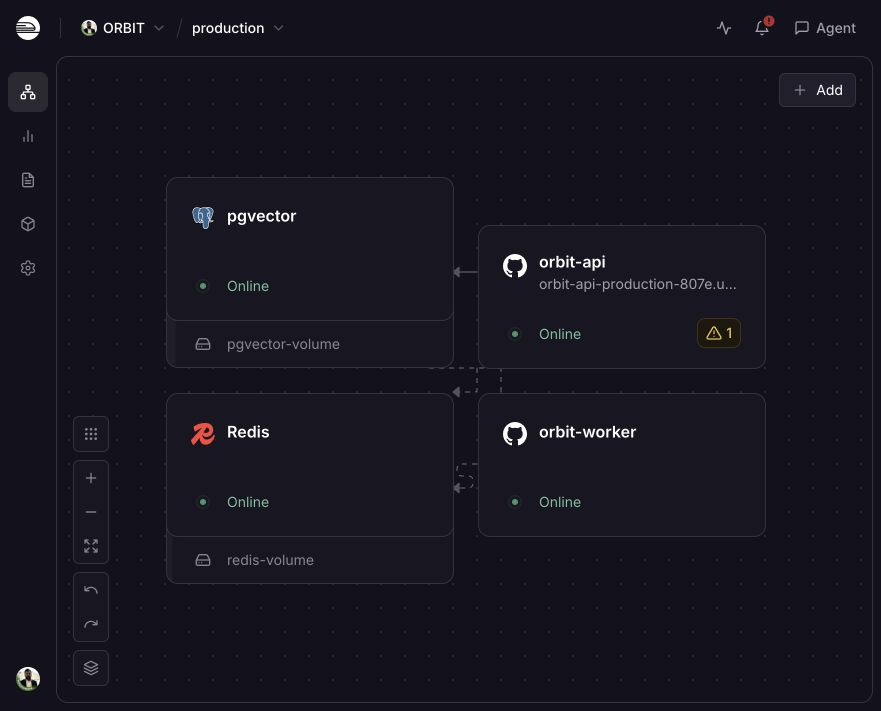
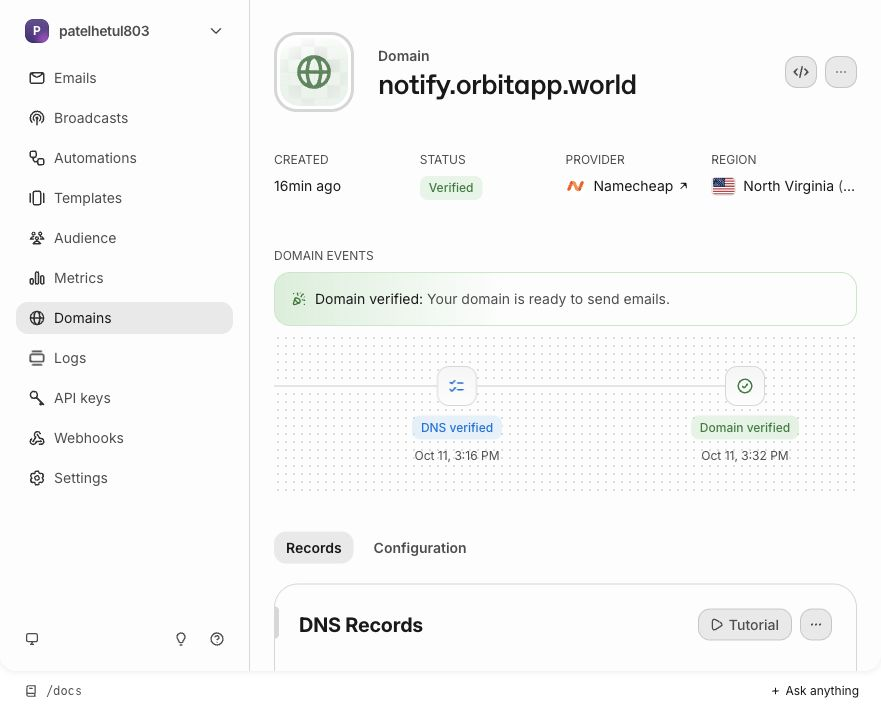
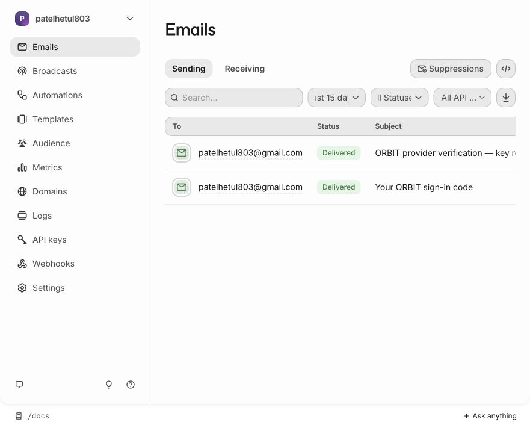
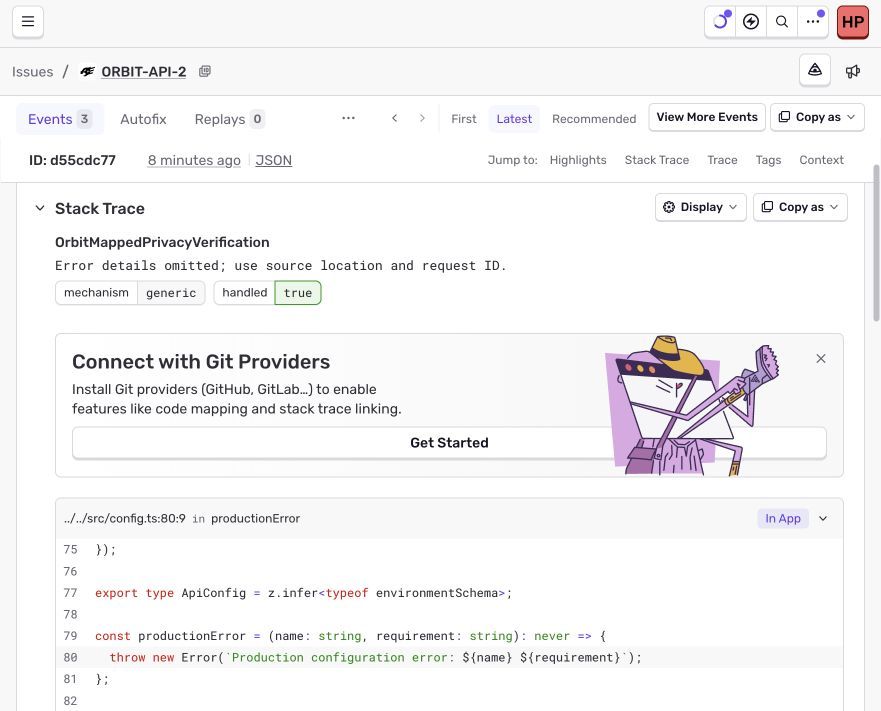

# ORBIT provider and deployment verification

Evidence date: October 11, 2026. This updates provider/deployment evidence, not a claim that the entire requested phone launch is complete. Product screens, buttons and APIs are inventoried in [PUBLIC_ALPHA_VERIFICATION.md](PUBLIC_ALPHA_VERIFICATION.md); the remaining feature backlog is retained there.

## Decision and usable URLs

- [Local UI](http://localhost:8081/agent): running, founder's existing browser account preserved.
- [Deployed API](https://orbit-api-production-807e.up.railway.app/health): running over public HTTPS; [readiness](https://orbit-api-production-807e.up.railway.app/ready) is HTTP 200 with database ready.
- [Owned homepage](https://orbitapp.world/), [privacy](https://orbitapp.world/privacy/), [terms](https://orbitapp.world/terms/), [support](https://orbitapp.world/support/): live public HTTPS documents. Downloads stay unavailable until real artifacts exist.
- [Expo ORBIT project](https://expo.dev/accounts/hetul/projects/orbit): created in the founder's existing account. No signed build or submission exists yet.

At 23:02 UTC on October 11, both local and deployed `/ready` were HTTP 200, and localhost `/agent` was HTTP 200. Public alpha status is capacity 100, admission false, waitlist available, reason `safety_coverage`. An unauthenticated `/v1/me` is HTTP 401. Workstation HTTPS reachability is proven; cellular/independent-network reachability is not yet personally tested.

**Not ready to invite strangers.** No physical phone installation, production founder signup, Google grant/sync, actual two-device reveal, native push receipt, staffed moderation, backup restore or complete deployed ten-check matrix is claimed.

## Railway: actual deployment

Separate ORBIT project `2adb816f-2c53-4bed-bfe8-f77de16a56a3`, production environment `04a64073-5c92-4f6b-b810-5d33609b493c`. Four services are online; one running replica each, zero crashed replicas, region us-west2, no pending changes. All four have CPU limits of 0.25 vCPU.

| Service  |        Memory cap | Networking / storage                              | Verified active deployment             |
| -------- | ----------------: | ------------------------------------------------- | -------------------------------------- |
| API      | 500,000,000 bytes | Public HTTPS, target 4100; no volume              | `676b66d1-efc1-42cf-9b79-fbba221957f2` |
| Worker   | 500,000,000 bytes | Private, no public listener/domain                | `2974adba-bb75-4245-a55c-4e449dc3b8bb` |
| pgvector | 500,000,000 bytes | Private; 5,000 MB volume at `/var/lib/postgresql` | `a75cf4c9-fb9c-4356-adca-de59b441743c` |
| Redis    | 250,000,000 bytes | Private; 5,000 MB volume at `/data`               | `9e7eba46-8df4-4274-9c98-f5bd24677b9c` |

API and worker use Hetul803/ORBIT, pinned commit `92d81991f15d82f7b5ed91c34937524cc10e11c5`, explicit Dockerfile paths `infra/Dockerfile.api` / `infra/Dockerfile.worker`. API pre-deploy runs `pnpm --filter @orbit/db migrate:deploy`; all sixteen production migrations applied successfully. No seed command used. Database account count/extension SQL and a backup restore are separate outstanding checks; image selection/migration success alone is not their proof.

API starts with `pnpm --filter @orbit/api start`; host 0.0.0.0, API_PORT and PORT both 4100, readiness path `/ready`, 300-second startup allowance. Worker starts with `pnpm --filter @orbit/worker start`; logs show `worker.ready`, schedules and subsequent completed jobs. Successful platform status alone was not accepted as worker health: the initial worker had restarted despite a platform SUCCESS badge.

Private database/Redis variables reference the services directly rather than an empty nested shared reference. PostgreSQL/Redis have no public TCP proxies or domains. Redis has password authentication, AOF/every-second persistence, 160 MB maxmemory and noeviction. Database currently uses the template's privileged runtime user; migrator/runtime least-privilege separation remains work. One API replica preserves process-local safety invalidation assumptions; horizontal socket revocation is unfinished.

Configuration-file opt-in is unavailable for these new Railway services in the inspected dashboard. Explicit source/build/deploy/watch fields and `RAILWAY_DOCKERFILE_PATH` were applied instead; the checked-in JSON alone is not claimed to control deployment. Future source edits must respect configured watch paths. No plan upgrade, public database exposure or signup-gate change occurred.

### Failed attempts and exact repairs

1. Connector deployment returned cancelled repeatedly without a user confirmation. Founder confirmed no dialog appeared, then explicitly approved the dashboard alternative. Railway-only permission remained Allow read actions; global settings and unrelated plugins were preserved.
2. Initial API image built, but pre-deploy failed because DATABASE_URL resolved empty. Runtime also warned that OpenSSL was missing. The direct private service reference repaired connection resolution; commit `92d8199` added OpenSSL and CA certificates to both images.
3. Initial worker source-map upload failed and restarted; correct private variables and repaired build produced successful upload and `worker.ready`.
4. Repaired API ran sixteen migrations and listened on 4100, but Railway probed a different PORT; deployment failed health activation. Explicit `PORT=4100` fixed the probe. Healthcheck was not disabled. [Railway probe semantics](https://docs.railway.com/deployments/healthchecks).

Final API succeeded 22:41:01 UTC; worker succeeded 22:36:12 UTC. Railway still shows two historical API failures and one warning. Do not call the history clean or dismiss the warning as a verified harmless condition.

## Resend and DNS

`notify.orbitapp.world` is Verified in Resend, sending enabled, receiving disabled. Domain ID `30c0f415-1fc0-4dfd-a0d1-951fb9031fcb`. Approved records saved at Namecheap, preserved after reload, independently resolved:

- TXT `resend._domainkey.notify`: provider DKIM public value, not an API secret.
- CNAME `rsend.notify` → `rsend.forge.rmta.net`.
- CNAME `send.notify` → `send.forge.rmta.net`.

Existing landing A/TXT records preserved; root mail, DMARC, nameservers, DNSSEC and receiving were not changed. The approved Gmail support address is sufficient to configure consent/support; domain-branded mailbox purchase is optional and was not performed.

The sending-only API key is restricted to this domain, installed into ignored 0600 local files and only ORBIT API/worker Railway variables. Both local processes restarted to load it. Real OTP delivery mode is Resend, not log mode; no on-screen OTP. Founder email receipt ID `01a12cb1-21b1-7904-9752-02d3aad17e71` shows Delivered. Founder personally entered OTP/name/date of birth and confirmed onboarding; no private code or birth date was requested in chat.

### Credential incident and remediation

An old sending key was accidentally included in a tool response while inspecting Railway's multiline raw variable editor. This was a real disclosure, not merely a provider prefix. It could send domain mail but could not manage the Resend account. The founder explicitly approved replacement and revocation. A new sending-only, same-domain key was created, privately installed locally/API/worker, and verified with a labelled technical email. Old key record `fe298089-7907-4f62-b42c-31529ec1b2ca` was permanently deleted; new record `1640e8e5-aca5-48d9-8bbd-6ad57da0ee60` remains. No key value appears in this report.

Replacement test receipt `01a12d0d-e4b3-74e8-bbfa-86821dfb2f7c` shows Delivered. Subject/body clearly identify a key-rotation provider check, not a genuine safety report. It does **not** prove actual moderation delivery, human response, native push or production OTP issuance. Future raw editor inspection is non-emitting, returns allowlisted metadata only, and screenshots occur only after closing secret-bearing editors.

Free quota: 3,000/month, 100/day, shared by OTPs/retries/operator alerts. No paid upgrade purchased. [Pricing](https://resend.com/pricing).

## Sentry: what is actually proven

Dedicated `orbit-api`, `orbit-worker`, `orbit-mobile` projects in organization `gsin-bb`; unrelated existing project preserved, no GitHub integration. Approved `org:ci` source-map token is organization-wide release-upload authority, not project-exclusive. It stays private and never uses EXPO_PUBLIC. Free Developer plan: 5,000 errors included, no payment method, ended trial; no paid trial started.

Actual API/worker source-map upload succeeded locally and during production startup. Early diagnostic uploads lacked embedded source content; `inlineSources:true` plus Turbo's tsconfig global dependency fixed that. Compiled guard diagnostics on release `orbit@0.1.0+95b1b20` display original config source lines without Processing Errors. Deployed services use release `orbit@0.1.0+92d8199` and logged upload success. A synthetic local guard error is **not** a production-route crash. Mobile project ingestion was tested using a Node diagnostic, not the React Native SDK/device; native stacks and phone delivery remain unverified.

Node Sentry v11 collection was explicitly narrowed: no user information, cookies, request headers/bodies/query values, model input/output, database query payloads, queue payloads, GraphQL documents/variables or stack variables. Performance sampling zero; breadcrumbs omitted. Shared scrubber removes user/request/context/extra/message/logentry/server_name data, genericizes exception text, retains source locations and only allowlisted correlation tags. Mobile has its compatible SDK privacy settings and shared scrubber; this is code inspection/test evidence, not installed-device certification.

Project controls saved on all three: data/default scrubbers, Prevent Storing IP, sensitive field names and advanced removal selector `$user.geo.*`. The first `$user.geo` rule did **not** remove vendor-inferred geography and was corrected. New API event `a0eef48dfa644253b87bbefa205831d7` then visibly had no Geography field and retained mapped source lines. Worker/mobile wildcard settings are saved, but a fresh post-wildcard ingestion/inspection for those two is not yet confirmed. Older diagnostics may retain inferred coarse geography; they were not deleted. No browser-protected JSON endpoint was bypassed.

## EAS and signing

Founder is signed into existing account `hetul`; ORBIT project created with slug `orbit`. Project UUID is stored in EAS environment settings, not hardcoded into repository config. Seven project-only variable names are prepared/saved for production, preview and development: public project ID, HTTPS API URL, WSS stream URL, mobile ingestion DSN; SENTRY_ORG, SENTRY_PROJECT, and Secret-visibility SENTRY_AUTH_TOKEN. No server signing/encryption/Google/OpenRouter/Resend key is a mobile public variable.

Browser sign-in and CLI authentication were separately verified. Founder encountered permission denied in his terminal; official CLI browser login subsequently succeeded without sudo/chmod or an account-wide API token. Both authenticated config commands load the intended environments and resolve version 0.1.0, package/bundle com.orbit.companion, initial build/code 1, Updates appVersion policy and the mobile Sentry plugin. Cloud build/native runtime are not yet proven. Founder reports paid Apple membership; Apple team/signing access needs his participation. No paid EAS plan, TestFlight submission, public store submission or Android keystore creation has occurred.

Production iOS profile uses remote versioning/auto-increment; preview produces signed APK after signing setup. Existing dynamic Updates config is enabled only with EAS project ID and appVersion runtime policy. Updates must be proven on installed compatible binaries; config presence is not delivery. Exact click paths in [LAUNCH_CHECKLIST.md](LAUNCH_CHECKLIST.md).

## Tests, data and code changes

Latest full release: **148 passed, zero failures/skips** (129 Vitest: shared 2, LLM 9, agent 17, mobile 49, worker 13, API 39; 19 Node scripts). Fresh isolated databases `orbit_test_release_final_20261011` / `orbit_test_release_alpha_20261011`; all sixteen migrations applied. Primary remained intact. Local log `/tmp/orbit-release-final-tests-20261011.log`. Provider mocks verify transactional ordering and server behavior, not delivered push/mail. Historical coverage percentages remain labelled historical in the main report.

An intermediate rerun reused a filled test database and failed six account-creation checks at the 100-account limit. Fresh isolated databases restored the intended fixtures without wiping primary or weakening cap assertions. Lint/typecheck passed eight packages; format and server builds passed. Docker repairs subsequently built and booted on Railway. Hosted [CI 38180581003](https://github.com/Hetul803/ORBIT/actions/runs/38180581003) did not execute due to GitHub billing lock. Two unpatched high advisories remain open; audit was not disabled.

New provider work beyond original product requirements: guarded provider credential importer and approved key-rotation helper with synthetic tests; explicit error-only telemetry/privacy defaults; mapped-source fix/cache invalidation; Docker TLS/OpenSSL prerequisites; isolated production deployment/caps; verified sending DNS and EAS environment linkage. These are implementation improvements, not proof of an uncopyable moat or guaranteed retention.

Private `.env`, `.env.providers.local`, `.env.production.local` are ignored and mode 0600, checked again after rotation. Fresh production secrets differ from development and one another. No local-only Google key copied into hosting; no ADMIN promotion or coverage confirmation inferred. Credentials must never be put into reports, commits, screenshots, issue bodies or public bundles.

## Remaining release blockers

Signed iOS/APK and actual installs; production founder admission through explicitly approved staff setup; deployed Google client/callback and founder grant; Catch real sources; two-device mutual reveal; airplane/API-loss/cost-cap/delete/export sweep; actual native push/report response drill; staffed primary/backup 15/60-minute commitment; database least privilege and backup restore; ingress/IP testing; native Sentry; Google applicable verification; security advisory handling and hosted CI; real reviewer account/store-size native screenshots; approved public TestFlight link and stable APK digest. Public signup remains closed. [Costs and operating limits](BUDGETED_DEPLOYMENT.md).
