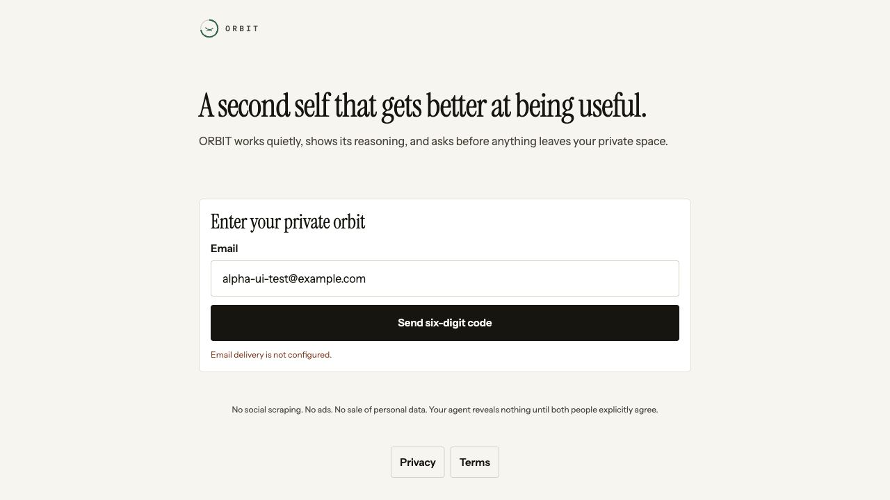
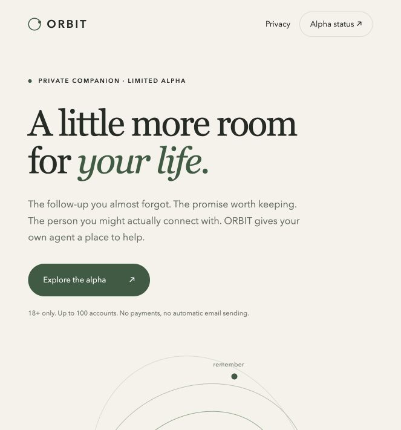
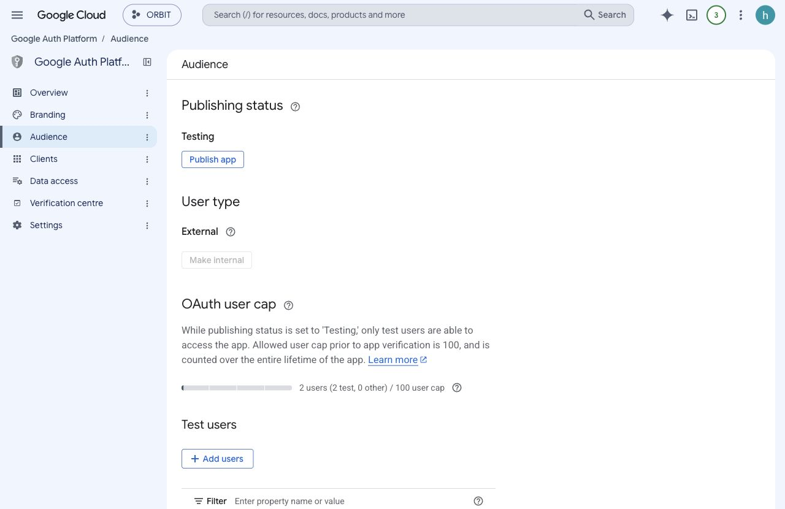
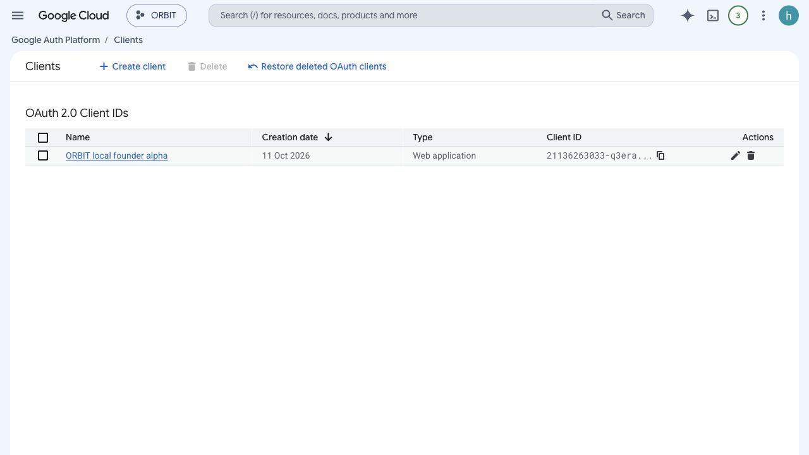
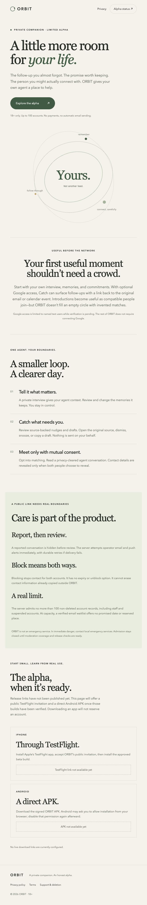

# ORBIT — current build, public-alpha safety and launch report

Evidence date: October 11, 2026. This is the current addendum to the original 31-feature build and Passes 2–5, including the founder's public-alpha requirements. Older reports preserve historical evidence; they do not override this report's launch limits.

## 1. The decision

**The app runs locally and the new safety/admission behavior is implemented and tested. ORBIT is not yet delivered as a deployed, signed, publicly installable phone alpha. Do not invite strangers yet.**

Use [local ORBIT](http://localhost:8081/sign-in) to see the app. The API runs at `http://127.0.0.1:4100`, with PostgreSQL/pgvector and Redis. `/ready` returned HTTP 200 on October 11. The worker runs its schedules with its own daily model caps set to zero to prevent unattended paid calls. In the subsequent budget follow-up, the founder set a $100/month total ceiling: root `.env` and the restarted API/router now use 10 cents/user/day and 50 cents shared/day. Forty-three existing local accounts were preserved; the primary database was not wiped or reseeded. All sixteen migrations are applied.

Deployment follow-up: the founder authorized hosting, but the subsequent Railway deployment confirmation was declined. API, worker, private Redis and versioned pgvector plus two volumes remain **staged, zero live services**. Provider free-account forms are prepared for founder sign-in; no Resend/Sentry credentials or deployed API exist yet. [Actual staging state, budget allocations, limits and next steps](BUDGETED_DEPLOYMENT.md). No alternate-route deployment was performed.

Real email delivery is not configured locally. Clicking **Send six-digit code** produces **“Email delivery is not configured.”** No code is displayed, no success is fabricated, and no login bypass was added. The local Google OAuth client is configured privately; real Google access still requires a signed-in ORBIT account and the founder's separate Google grant. A landing page is not a deployed API; a passing web export is not a signed iOS/Android app.

The published landing page is [ORBIT public alpha](https://orbitapp.world/). Homepage, privacy, terms and support all returned HTTPS 200 after DNS/TLS propagation; the custom domain is active. Its download areas correctly say unavailable: no approved public TestFlight link or signed direct APK exists. The four Namecheap records were saved and verified after reload. [DNS evidence and exact records](DOMAIN_SETUP.md). The approved public support address is present in static legal/support pages even without JavaScript.

The founder confirmed creating a separate Google project. The console shows **ORBIT / `orbit-511108`**, with a previously unconfigured Auth Platform. Gmail and Calendar APIs are enabled; consent is **External / Testing** with approved contacts and explicit policy acceptance. Owned-domain branding and only Gmail/Calendar read-only scopes are saved. **ORBIT local founder alpha** is a Web OAuth client with exactly one localhost callback; its generated credentials were imported into ignored, mode-0600 root `.env`, not Git, screenshots or chat. No other app's project was reused. No billing account, paid Cloud resources, production Google publishing or mailbox grant was created. Remaining OAuth/verification details below must not be inferred from enabled APIs.

## 2. Requirement-by-requirement result

| Required outcome                                      | Implemented behavior                                                                                                                                                                                                 | Actual proof / remaining release requirement                                                                                                                                                                                       |
| ----------------------------------------------------- | -------------------------------------------------------------------------------------------------------------------------------------------------------------------------------------------------------------------- | ---------------------------------------------------------------------------------------------------------------------------------------------------------------------------------------------------------------------------------- |
| Newly created ORBIT-only Google project               | Exact project identity configured locally; enabled APIs, new consent, owned-domain branding, approved read-only scopes and local Web client in `orbit-511108`                                                        | Founder creation confirmed and console inspected. Local credentials private; separate founder grant and public verification remain outstanding.                                                                                    |
| Immediate report email **and** push                   | Transactional outbox creates both channels for each configured operator. API attempts both after suppression commits; worker retries every five seconds                                                              | Real PostgreSQL tests with mocked Resend/Expo prove ordering, two-channel requests, failure retry and deduplication. Actual inbox and signed-device arrival are **not** proven.                                                    |
| Reported conversation suppressed before review        | `suppressedAt` is independent of worker status; participant reads, transcript, reveal and outcome access fail; meeting-plan links revoked; queued introduction pushes cancelled                                      | Tests verify both users and known URLs are denied before provider calls. Dismissing/restoring never unsuppresses. Existing copied bytes cannot be recalled.                                                                        |
| Response runbook and time commitment                  | Required 15-minute acknowledgement, 60-minute first action, continuous primary plus backup coverage; first action does not require premature case closure                                                            | [Runbook](MODERATION_RUNBOOK.md) written. Named operators, schedule, backup, real drill and founder coverage acceptance remain missing. A document is not staffing.                                                                |
| Instant, bidirectional, permanent block               | Pair lock and current DB checks in both directions; no expiry/unblock route; DB rejects soft-unblocking                                                                                                              | Concurrent read/reveal/proposal protections and stale brief/inbox/plan access tested. Permanent for these accounts, not every possible future identity.                                                                            |
| Hard maximum 100 accounts                             | Global PostgreSQL admission lock serializes verified registrations. Counts all non-deleted accounts including staff, suspended and grace-period deletion accounts. Configuration can lower, never raise, the ceiling | Test starts at 99 and races two registrations: only one is admitted; final count is 100. Returning accounts still sign in when full/paused. No real account database was filled to demonstrate this.                               |
| Honest full-capacity waitlist                         | Verified-email-only proof; ten-minute purpose-bound token; explicit join consent; idempotent join; confirmed removal; no account/date/reserved slot promised                                                         | API and mobile tests cover full/paused routing, forged/expired or non-auth proof, failed join and removal. Real OTP delivery remains necessary to use it.                                                                          |
| Distinct reconnect prompt measurement                 | `google.token_expired`, `google.reconnect_prompt_shown`, `google.reconnect_started`, `google.reconnected` are separate events                                                                                        | Concurrent prompt exposure deduplicates per real expiry episode. Focused `/connections` or `/catch` plus foreground AppState required. Background/error/status polling is not retention. Physical Google expiry test remains open. |
| Public TestFlight + direct Android APK on own landing | Validated release configuration, Apple public-join URL constraint, HTTPS `.apk` and SHA-256 requirement; unavailable states until supplied                                                                           | Public landing deployed. Actual signed binaries, review, public URLs and physical installs **not delivered**.                                                                                                                      |
| Own-domain homepage and privacy for Google            | Public static homepage, privacy, terms and support; Namecheap A/TXT records saved; domain active                                                                                                                     | All four owned-domain HTTPS paths returned 200. Google ownership verification remains separate from the Sites TXT challenge.                                                                                                       |

Production admission is deliberately **fail-closed**: explicit open and coverage flags; every operator has an ACTIVE ADMIN/MODERATOR account and native push device; no unsent alert older than one minute; no open report beyond 15 minutes without acknowledgement or 60 minutes without first action. Local development intentionally bypasses this operational gate for testing. A local `acceptingNewAccounts: true` response is not proof production can safely open.

## 3. What the product currently does

These are capability descriptions, not a claim that every button was exercised on both phones. “Implemented” means code/UI/API exists; “verified locally” names the actual evidence. [Historical complete control/API inventory](BUILD_AND_LAUNCH_AUDIT.md) and [Pass 5 behavior and real-model transcripts](PASS5_VERIFICATION.md) provide earlier detail with their original dates and limitations.

### Private agent and single-person value

| Feature / control              | How it works                                                                                                                                                                                       | Readiness and limits                                                                                                                                                                 |
| ------------------------------ | -------------------------------------------------------------------------------------------------------------------------------------------------------------------------------------------------- | ------------------------------------------------------------------------------------------------------------------------------------------------------------------------------------ |
| Email sign-in, verify, resend  | Real adapter request; six-digit one-use OTP; incorrect-attempt limits, cooldown, age gate, rotating refresh token. Mobile never displays/autofills development codes                               | DB integration covers abuse/consumption. Live missing-provider error verified. Actual email required; not usable authentication today without Resend.                                |
| Interview → name agent → Today | Saved question/draft/session survives navigation; bounded adaptive model route with honest fallback questions; completed named agent has durable onboarding marker                                 | Restore/completed-account tests pass; earlier real-provider synthetic interview ran. No signed-phone killed-app/fresh-install proof.                                                 |
| Import history                 | User-selected JSON/ZIP parsed into bounded memory/profile facts; raw upload not retained; learned items inspectable/removable                                                                      | Parser/limits exist; arbitrary real founder exports and native file picker need device QA.                                                                                           |
| Agent identity                 | Unique identity seed, named agent, existing Ring assets and component system                                                                                                                       | Not a trademark, identity verification, or an uncopyable visual moat. Exact original design/device compliance still has issue #9.                                                    |
| Memory and layered profile     | Review/correct/forget facts; provenance, confidence, canonical keys, active/superseded/retired state; five profile layers and expiring transient state; correction receipts; configured embeddings | Prior real synthetic memory/vector and portability evidence exists. No provider key means no invented vector. Current API tests cover key boundaries, not all imports and conflicts. |
| Profile export/import          | Versioned portable profile plus skills/outcome summaries; separate signed full-account ZIP export                                                                                                  | API export signature test passes and wrong key fails. Phone download/share UX, production key management and full portability compatibility remain unverified.                       |
| Trust dials                    | Ask first / Do and tell / Just handle it per capability; external human-visible writes remain approval-gated                                                                                       | Local persistence and policy tests exist. Does not make arbitrary external tasks executable.                                                                                         |
| Catch                          | Source-backed follow-up, promise, date, renewal and calendar-overlap signals; open source, dismiss, snooze until tomorrow, copy draft receipt                                                      | Useful to one user after Google sync. Real mailbox path not run. Draft is **NOT SENT**; copy never sends mail.                                                                       |
| Ask                            | Interprets structured intentions/watchers and answers from available life sources with citations/confidence; says no evidence when unsupported                                                     | Tested representative interpretation/grounding paths. Not a universal executor or bank-statement analyzer.                                                                           |
| Proactive suggestions          | Bounded types, inspect/propose/act policy, explicit promotion consent, distinct acceptance evidence, dismissal downgrade                                                                           | Prior API evidence exists. No autonomous purchase, mail-send or calendar-write authority.                                                                                            |
| Today and brief                | Work counts, pending decisions, Catch, watcher hits, runs and deep links; honest empty state                                                                                                       | Server removes suppressed/blocked introduction items from old stored briefs. Social briefs are no longer persisted to disk.                                                          |
| Watchers                       | Direct public page or configured search source, schedule, threshold, deduped hits, pause/resume/delete, hit history                                                                                | Prior direct-URL fetch/deduplication proof exists. Search provider and deployed schedule still need live verification; internet access is constrained against unsafe targets.        |
| Run history/cost receipts      | Steps/status, model/provider, tokens, durations, budget pause, tracked estimated cost and skill-efficiency receipts                                                                                | Representative local tests and prior real calls. Estimated receipts are not provider invoices; no trace-waterfall UI.                                                                |

An honestly empty Circle is preferable to fabricated matches. The interview, editable profile, skill inspection, own watchers and source-backed Catch can provide single-user utility. Whether that utility retains one or five users must be measured with real use; it cannot be promised from a test suite.

### Two-person and group value

| Feature / control       | How it works                                                                                                                                               | Readiness and limits                                                                                                                                                                                                   |
| ----------------------- | ---------------------------------------------------------------------------------------------------------------------------------------------------------- | ---------------------------------------------------------------------------------------------------------------------------------------------------------------------------------------------------------------------- |
| Intentions              | Kind-specific activate/pause/settings, pause dates and activity receipts feed matching                                                                     | Implemented UI and server. A useful population and real embeddings/models are needed for introductions.                                                                                                                |
| Nightly matching        | Candidate filters/vector retrieval, rerank, bounded two-agent conversations, privacy redaction, independent judging, caps, introduction and brief creation | Real synthetic-model evidence in Passes 4/5. New safety checks prevent a report/block racing completion from resurfacing content. Not proven to generate good real relationships.                                      |
| Transcript              | Redacted alternating conversation, score/reasons and suggestion; uncertain privacy fails closed                                                            | No raw failed-redaction substitute. Pass 5 observed 0 failures in 10 synthetic pairs, not a privacy guarantee; prompts remained repetitive.                                                                            |
| Reveal / decline        | Final independent decisions; intersection of field choices only after both consent; decline not exposed as the other party's private decision              | Mutual reveal DB regression passes. Pair locks, current suppression/block checks prevent concurrent safety bypass. Two-phone release proof remains open.                                                               |
| Outcome                 | Met/not-yet, rating/private notes produce labeled feedback                                                                                                 | Stored locally/API. Automated evidence-based reranker improvement and real retention/outcomes remain incomplete.                                                                                                       |
| Exchange                | Have/want listing terms, condition/budget/trade/urgency; editing/deleting and worker proposals; mutual accept before handoff; no payment handling          | Historical local two-party proposal evidence. No separately negotiated agent transcript or payment service; finalized meeting details rely on safety plans.                                                            |
| Inbox/screening         | Internal peer requests and approval/decline; ordered screening rules and preview; explicit draft edits                                                     | No email send adapter. Blocked peers are filtered from reads/actions/preview; approving an internal item is not external email delivery.                                                                               |
| Skills                  | Inspect trigger/steps/rules/checks/permissions/fallback/versions/evidence; create/correct/share/adopt; lineage and review of updates                       | Not a general-purpose execution engine. Validation/transfer improvements do not prove every named skill actually accomplishes useful work.                                                                             |
| Groups/shelf            | Join code/domain/roles, group-owned skills, role-aware publication and adoption/update review                                                              | No GitHub/club work ingestion or coordinated project execution. Multi-user roles/propagation need release QA.                                                                                                          |
| Meeting safety          | Public-place/time plan, shared token, safe check-in receipt                                                                                                | Report/block revoke plan links, including legacy suppressed plans via migration 15. Device reminders not proven. Public plan links are bearer capabilities, not private login links.                                   |
| Mute                    | Server records a user-specific mute; safety UI exposes controls                                                                                            | Mute is distinct from a permanent bidirectional block. Delivery behavior still needs native tests.                                                                                                                     |
| Activity                | Attributed receipts for approvals, consent, changes, safety and staff actions                                                                              | Application append-only behavior; not an independently immutable/write-only audit service.                                                                                                                             |
| Delete account / cancel | Seven-day grace status/cancel flow and worker deletion; token revocation and sign-out                                                                      | DB regression passes. Physical deadline/cancellation UX and all legal-retention boundaries need review. No authenticated outside-app deletion request implemented.                                                     |
| Phone and campus verify | Request/verify controls and status                                                                                                                         | Campus needs real email delivery. Production SMS adapter remains incomplete; no invented phone success. Age gate is self-reported eligibility, not document verification.                                              |
| Push preferences        | Native device registration/preferences/unregister, queue/deep-link configuration                                                                           | Browser appropriately cannot register native push. Signed APNs/FCM/Expo device delivery unverified. Safety operator push ignores consumer opt-out so on-call alerts cannot be muted by ordinary preferences.           |
| Admin                   | Role gate, oldest-first reports, five-second refresh, audit, safe transcript, acknowledge/first action/closing actions/reasons, costs/metrics              | Current DB role/status checked rather than trusting old JWT claims. Test staff actions pass; live operator account/device drill still missing. Warn is an audited decision, not an automatically sent warning message. |

### New and changed controls in this pass

- **Waitlist: Join** records only the verified email after consent; failed network/server response does not claim success. **Remove** first asks for confirmation; **Cancel** leaves the entry alone. **Verify email again** handles expired/missing proof. **Existing member sign-in** remains available. Tokens are transient, not stored in a URL or persistent auth store.
- **Safety: Block this person** is a two-step permanent-block confirmation; **Cancel** performs no mutation. Busy controls prevent duplicate actions; changing subject resets confirmation. A successful server action is not mislabeled failed if a later cache refresh fails.
- **Safety: Send report** shows actual conversation suppression and whether operators are configured/provider accepted/retry is pending. A report with no attached conversation does not falsely claim one was hidden. Check-in failures are caught and shown.
- **Admin: Review redacted conversation** requires current staff authorization and creates an access receipt. **Acknowledge** keeps the case under review. **Record first action** sets a separate timestamp without resolving. **Dismiss / Warn / Suspend / Restore** require reason and UI confirmation; none removes permanent blocks or reported-conversation suppression. A late acknowledge cannot reopen a closed case.
- **Connections/Catch: Reconnect Google** offers explicit reconnection after expiry. Measuring the visible prompt is non-blocking and deduplicated; it does not silently restart consent or count as regular retention. In production Testing mode, unlisted Google users get a clear unavailable state and denied start/sync/callback, while the rest of ORBIT remains accessible.
- **Landing: Explore alpha / Alpha status** scroll to release status. Privacy, Terms and Support are public documents. Actual Apple/APK links appear only after valid configuration; placeholders are not dead links or downloads. A configured hash is displayed, but physical binary signature/digest verification is still a release step.

No comprehensive touch-by-touch phone sweep is claimed. Runtime tests cover the new high-risk buttons; existing historical web sweeps and source checks are not equivalent to physical-device evidence.

## 4. Complete current API surface

All ordinary `/v1` resources require current authenticated account access. Public exceptions: health/readiness/legal, OTP request/verify/refresh, alpha status, purpose-token waitlist, single-use-state Google callback and bearer-token meeting-plan share. Staff routes additionally require current ADMIN/MODERATOR role. Schemas are revalidated server-side; mobile typing is not authorization.

| Area                    | Exact methods/paths                                                                                                                                                                                                            | Purpose / limits                                                                                                                        |
| ----------------------- | ------------------------------------------------------------------------------------------------------------------------------------------------------------------------------------------------------------------------------ | --------------------------------------------------------------------------------------------------------------------------------------- |
| Health                  | `GET /health`, `GET /ready`                                                                                                                                                                                                    | Process health; actual DB readiness, not full provider readiness.                                                                       |
| Realtime                | `GET /v1/stream` (WebSocket)                                                                                                                                                                                                   | Advisory authenticated invalidations. Safety hub is process-local: deploy one API instance until shared fan-out exists.                 |
| Legal                   | `GET /privacy`, `GET /terms`, `GET /support`                                                                                                                                                                                   | API-served public notices; landing has separate static equivalent paths with trailing slash.                                            |
| Email auth              | `POST /v1/auth/otp/request`, `POST /v1/auth/otp/verify`, `POST /v1/auth/refresh`                                                                                                                                               | Delivery/one-use verification/admission and rotating session.                                                                           |
| Extra verification      | `POST /v1/auth/verify-edu/request`, `POST /v1/auth/verify-edu`, `POST /v1/auth/verify-phone/request`, `POST /v1/auth/verify-phone`                                                                                             | Real provider-dependent campus/phone verification, never production log adapter.                                                        |
| Admission               | `GET /v1/alpha/status`, `POST /v1/waitlist`, `DELETE /v1/waitlist`                                                                                                                                                             | Capacity/readiness plus purpose-bound verified-email join/remove. Waitlist proof cannot authenticate to `/v1/me`.                       |
| Account                 | `GET/PATCH/DELETE /v1/me`, `GET /v1/me/deletion`, `POST /v1/me/deletion/cancel`, `GET /v1/me/export`                                                                                                                           | Account settings, grace-period deletion/cancel and signed full export.                                                                  |
| Agent                   | `POST/GET/PATCH /v1/agent`, `POST /v1/agent/interview/turn`, `POST /v1/agent/import`                                                                                                                                           | Own-agent lifecycle, bounded interview and archive import.                                                                              |
| Memory                  | `GET /v1/agent/memory`, `PATCH/DELETE /v1/agent/memory/:id`                                                                                                                                                                    | Owner-scoped facts/correction/forget.                                                                                                   |
| Layered profile         | `GET /v1/profile`, `POST /v1/profile/consolidate`, `GET /v1/profile/export`, `POST /v1/profile/import`                                                                                                                         | Consolidation, state expiry and portable profile.                                                                                       |
| Intents                 | `GET /v1/intents`, `PUT /v1/intents/:kind`                                                                                                                                                                                     | Own intent activation/parameters/pause.                                                                                                 |
| Connection/key settings | `GET /v1/connections`, `PUT /v1/settings/api-key`                                                                                                                                                                              | Connection metadata and encrypted personal provider credential, not exposed in client reads.                                            |
| Google                  | `GET /v1/connections/gmail/status`, `POST /v1/connections/gmail/start`, `GET /v1/connections/gmail/callback`, `POST /v1/connections/gmail/sync`, `DELETE /v1/connections/gmail`, `POST /v1/connections/gmail/reconnect-prompt` | Combined read-only Google consent, encrypted token, progress/expiry/disconnect and distinct prompt exposure. No send/event-write scope. |
| Life                    | `GET /v1/life/catch`, `POST /v1/life/catch/:id/dismiss`, `POST /v1/life/catch/:id/snooze`, `POST /v1/life/catch/:id/copied`, `POST /v1/life/ask`                                                                               | Source-backed life items, actions and grounded answers. Copy receipt is not mail delivery.                                              |
| Proactive               | `GET /v1/proactive`, `POST /v1/proactive/:id/respond`, `PUT /v1/proactive/policies/:type`, `POST /v1/proactive/policies/:type/approve-act`                                                                                     | Proposals, feedback, autonomy policy and explicit promotion.                                                                            |
| Matching/intros         | `GET /v1/matching/status`, `GET /v1/introductions`, `GET /v1/introductions/:id`, `GET /v1/introductions/:id/transcript`, `POST /v1/introductions/:id/decision`, `POST /v1/introductions/:id/outcome`                           | Current status, protected transcript, two-sided consent/outcome. New visibility rules apply to export and stale reads too.              |
| Exchange                | `GET/POST /v1/exchange/items`, `PATCH/DELETE /v1/exchange/items/:id`, `GET /v1/exchange/proposals`, `POST /v1/exchange/proposals/:id/decision`                                                                                 | Own listings and safe peer proposals/mutual handoff. No payments.                                                                       |
| Brief/inbox             | `GET /v1/brief/today`, `GET /v1/inbox`, `POST /v1/inbox/:id/approve`, `POST /v1/inbox/:id/decline`                                                                                                                             | Authoritative brief and protected internal approval actions.                                                                            |
| Screening               | `GET /v1/screening-rules`, `POST /v1/screening-rules/preview`, `PUT/DELETE /v1/screening-rules/:id`                                                                                                                            | Ordered own-user rules and preview; blocked peers excluded.                                                                             |
| Watchers                | `GET/POST /v1/watchers`, `PATCH/DELETE /v1/watchers/:id`, `GET /v1/watchers/:id/hits`                                                                                                                                          | Structured source/schedule/criteria and hit history.                                                                                    |
| Runs                    | `GET /v1/runs`, `GET /v1/runs/:id`                                                                                                                                                                                             | Owner-scoped execution/steps/model receipts.                                                                                            |
| Skills                  | `GET/POST /v1/skills`, `PATCH /v1/skills/:id`, `POST /v1/skills/:id/share`, `POST /v1/skills/:id/adopt`, `GET /v1/skill-adoptions/updates`, `POST /v1/skill-adoptions/:id/review`                                              | Versioned procedures and explicit safe transfer/update review.                                                                          |
| Groups                  | `GET /v1/groups`, `POST /v1/groups/join`, `GET /v1/groups/:id/skills`                                                                                                                                                          | Member/role-scoped group access and shelf.                                                                                              |
| Safety                  | `POST /v1/blocks`, `POST /v1/mutes`, `POST /v1/reports`, `POST /v1/safety-plans`, `GET /v1/safety-plans/share/:token`, `POST /v1/safety-plans/:id/check-in`, `GET /v1/activity`                                                | Pair safety, immediate suppression/alerts and receipts. No unblock or unsuppression API.                                                |
| Staff                   | `GET /v1/admin/moderation`, `GET /v1/admin/reports/:id`, `GET /v1/admin/audit`, `POST /v1/admin/reports/:id/action`, `GET /v1/admin/costs`, `GET /v1/admin/metrics`                                                            | Attributed staff review/action; separate Google/safety metrics.                                                                         |
| Push                    | `GET /v1/push/devices`, `POST /v1/push/register`, `PATCH /v1/push/devices/:id/preferences`, `DELETE /v1/push/devices/:id`                                                                                                      | Own native device registration/settings and revocation.                                                                                 |

Errors use `error.code`, plain-language `message`, server-generated `requestId` and optional structured `details`. Logs use route templates rather than raw callback/query strings. Suspension/current role changes affect existing JWTs on the next authenticated request; refresh credentials are revoked and local sockets closed. Horizontally deployed socket revocation is not implemented.

## 5. Safety implementation in depth

### Report ordering and retries

`POST /v1/reports` verifies requester/subject/attached-conversation membership, takes a deterministic pair advisory lock, deduplicates an open report, suppresses the attached conversation, revokes safety-plan links, cancels pending intro pushes and writes alert rows/audit in one transaction. Only after commit do Resend and Expo requests happen. This order is verified inside mocked provider callbacks against the real test database.

Outbox rows have unique report/channel/recipient keys, claim leases, attempts and next-attempt timestamps. Claims prevent normal concurrent workers sending one pending row twice. Five-second provider deadlines avoid holding a request indefinitely. Retry backs off to at most 60 seconds; abandoned SENDING leases are recovered. Generic error codes are retained instead of private provider payloads. No permanent discard state is used. Email has a stable idempotency key; push can duplicate across ambiguous lease/network recovery.

`SENT` means **provider accepted**, not email inbox/device arrival or human acknowledgement. There is no Expo receipt polling or automatic human backup paging. The required real-provider drill must prove both channels on the actual phones and mailboxes. Push priority does not guarantee a notification bypasses OS focus modes.

### Permanent pair boundaries and client data

Blocks are checked in both account directions even if a historical soft-delete exists. Migration 14 restores those soft-deleted blocks and prevents new soft-unblocking. Matching, reveal, inbox/skill share and exchange creation use pair locks/current checks; final worker completion rechecks visibility. If a model is already running it may finish its call, but blocked/suppressed content is not published. This does not cancel incurred provider cost.

Introduction, transcript, brief, inbox and exchange caches are invalidated on safety events. Persisted social/brief caches are disabled and legacy disk entries cleared; personal Catch/offline queued writes retain their separate owner scope. Queries are cancelled before reset to reduce late refill. Previously delivered screenshots, copied contact data, browser/devtool bytes, exports and notifications remain outside recall. Server enforcement is decisive; clients never authorize reveal.

### Moderation deadlines

Acknowledgement and first protective action have separate timestamps. First action leaves an investigation REVIEWING when necessary; closing sets resolution. A follow-up acknowledge on a resolved case returns conflict instead of reopening it. Staff transcript access is audited and only exposes privacy-cleared text. Account restore never removes conversation suppression or a permanent block.

Required **15-minute acknowledgement / 60-minute first action** is documented but not staffed or accepted yet. The gate does not replace incident response, and pausing new accounts does not eliminate responsibility to existing users. [Full response and escalation runbook](MODERATION_RUNBOOK.md).

## 6. Google data and measurement

### Actual founder testing setup

Google project `orbit-511108` now has Gmail and Calendar APIs enabled, External/Testing consent, `orbitapp.world` as the authorized domain and live homepage/privacy/terms branding URLs. Only Gmail read-only and Calendar read-only scopes are saved; Gmail is shown as restricted and Calendar as sensitive. After navigating away and back, Audience shows **two test users and zero other users** and both supplied accounts in the persisted table. A transient conflicting eligibility notice was dismissed; the fresh in-console table confirmed the two exact account addresses. Neither account has granted ORBIT data access yet.

The Web client **ORBIT local founder alpha** has exactly `http://localhost:4100/v1/connections/gmail/callback` and no JavaScript origins. Its ID/secret live only in the ignored local root `.env`, mode 0600. The browser's JSON download event timed out, so a guarded mechanical importer saved the visible generated credential directly from session memory to `.env`; no credential was printed, pasted in chat or copied into a tracked file. `scripts/configure-google-oauth.mjs` validates the project, callback, tester configuration and existing values, preserves unrelated configuration, refuses production and uses an atomic 0600 replacement. Its three tests use synthetic credentials. The API was restarted to load the configuration and `/ready` returned 200.

The AI-agent-client checkbox was left unchecked for this standard, user-initiated server OAuth connector; it is not a Google MCP/action client. Production still needs a separate registered deployed callback/client, actual Google account consent, phone round-trip/sync/expiry proof, separate domain ownership and applicable public verification. No production publishing or verification submission occurred. Real email OTP delivery remains the first prerequisite for reaching the Google connection as a genuine ORBIT user.

The app requests `gmail.readonly` and `calendar.readonly`, not mail send or calendar write. First sync is bounded to mail in the last 90 days with up to 2,500 references and primary Calendar events in the next 14 days. Mail text is processed transiently; retained Gmail source records contain metadata/derived signals/source links, not bodies/snippets. Calendar descriptions are retained and disclosed. Catch/Ask drafts do not send. Refresh tokens are encrypted; disconnect erases local token and attempts Google revocation, without claiming revocation succeeded during an outage.

`invalid_grant` transitions a connection to EXPIRED once and records `expiredAt`. Only a focused, foreground visible reconnect prompt claims the distinct exposure event for that episode. Both screens racing produce one exposure. A failed telemetry request does not prevent the UI/reconnect action and can retry on later status refresh. Start and successful callback are separate counters, not ordinary app-retention events.

Testing-mode grants are not a public stranger-cohort exemption. Gmail read-only is **restricted**, not merely sensitive. General use requires Google's applicable verification and potentially a restricted-scope security assessment for server-handled Google data. The personally-known-small-group exception does not fit strangers. No fixed approval date is promised. Primary guidance: [Google scopes](https://developers.google.com/identity/protocols/oauth2/scopes#gmail), [production verification preparation](https://developers.google.com/identity/protocols/oauth2/production-readiness/sensitive-scope-verification), [restricted-scope verification](https://developers.google.com/identity/protocols/oauth2/production-readiness/restricted-scope-verification).

Until approved, production checks the explicit test-user allowlist on status/start/sync/callback and leaves the rest of the product available. Merely setting `GOOGLE_OAUTH_VERIFICATION_STATUS=verified` is not evidence of approval. The exact deployed HTTPS callback cannot be finalized before the actual API hostname exists; the landing host must not impersonate the API.

## 7. Verification evidence and its limits

Final full workspace `pnpm test:coverage` passed **140 tests, zero failures and zero skips** using Node 24, the separate seeded `orbit_test_regression_final_20261011` database and fresh empty `orbit_test_alpha_delivery_20261011`. The primary database was not used for integration fixtures. Provider calls in integration tests are mocked; real PostgreSQL is not mocked. Final command output is retained locally in `/tmp/orbit-alpha-delivery-tests-20261011.log`; it is not a permanent hosted artifact.

| Suite in full run | Tests | Statements / branches / lines                                  |
| ----------------- | ----: | -------------------------------------------------------------- |
| Shared            |     1 | 100% / 58.33% / 100%                                           |
| LLM               |     9 | 67.74% / 50% / 69.43%                                          |
| Agent             |    17 | 91.42% / 80.37% / 92.85%                                       |
| Mobile            |    49 | 73.85% / 59.17% / 74.86%                                       |
| Worker            |    13 | 58.89% / 40.09% / 61.62%                                       |
| API               |    39 | 44.09% / 27.70% / 45.56%                                       |
| Root Node scripts |    12 | Native Node tests; not included in Vitest coverage percentages |

DB/UI packages have no standalone coverage suite; shared DB safety helpers are exercised through API integration. These figures do **not** substantiate “every feature/button/API tested end to end.” API coverage remains materially incomplete.

New DB tests cover report-before-provider suppression, both participants/known URLs denied, plan revocation/push cancellation, role restrictions, staff audit/acknowledgement/first action/closure, two-channel retries and parallel claims, report dedupe, invalid participant denial, bidirectional permanent block, stale inbox/brief, suspension with old JWT, one expiry/one prompt episode, production readiness gates, Google eligibility, and 99→100 concurrent admission plus verified waitlist. Mobile tests cover full/paused routing, waitlist failures/confirmation, permanent block confirmation/cancel, committed-action cache failure, honest report receipt, reconnect dedupe/failure retry/background omission, and legacy offline social data.

Lint passed all eight packages. Typecheck passed all eight. Build passed all eight, including **47 Expo static routes**. Android prebuild finished successfully but emitted Expo autolinking memoization warnings. Final format/diff checks are recorded below. Static export and Android prebuild are not signed binaries or physical installation proof.

One intermediate run used test database names without the required `orbit_test` marker, so integration guards intentionally skipped those suites; that run is not release proof. A mobile waitlist test also raced a disabled removal button while the previous request was still finishing. The test now waits for the button to become enabled, then checks confirmation/cancellation; assertions were not weakened. The final fresh-database run above executed all suites without skips.

Live local sign-in input, disabled/enabled submit states and missing-delivery error were exercised. Landing content, unavailable downloads and Privacy navigation were inspected. The browser retained an actual 663px document width despite a 375px override request; that screenshot is therefore recorded as web/default-width, **not** claimed as phone responsive proof. The override was reset. Earlier Pass 5 phone-width browser screenshots remain historical evidence, not a current physical phone sweep.

The Oct 11 dependency audit still fails for **node-forge 1.4.0 / GHSA-86w9-cpqp-85rv** and **braces 3.0.3 / GHSA-vfj7-8cjw-p6xm**, both high severity with no patched version returned in the checked registry. Issues #31/#32 stay open; no gate was disabled. Hosted CI previously failed before executable steps because of GitHub billing; final post-push status must be checked rather than assumed.

Non-failing local warnings include React Native web accessibility prop warnings, PostgreSQL concurrent-query deprecation for a future driver version, and Expo color-environment warnings. No warning is represented as a passing physical-device result.

## 8. Infrastructure, credentials and economics

| Dependency                  | Current actual state                                                                                                                                                               | Needed                                                                                                                                                                  |
| --------------------------- | ---------------------------------------------------------------------------------------------------------------------------------------------------------------------------------- | ----------------------------------------------------------------------------------------------------------------------------------------------------------------------- |
| PostgreSQL/pgvector + Redis | Local reachable; sixteen migrations; existing user data retained                                                                                                                   | Private deployed services, backup/restore drill, least privilege, production migration and fresh unseeded release proof.                                                |
| Railway                     | Separate private ORBIT project; API/worker, private Redis/pgvector and two volumes staged. Chat approval received; subsequent deployment confirmation declined; zero live services | Retry authorization and accepted confirmation; apply resource/billing limits, connect source/config, install secrets and deploy. No public API URL exists.              |
| OpenRouter                  | Existing private root key; prior bounded real-model evaluation recorded 9.2902 cents for ten synthetic pairs                                                                       | Production server-only key and budgets, refreshed model prices, real-use receipts and billing alerts. This pass performed no new real-model evaluation.                 |
| Email                       | Resend adapter implemented; sender/key absent                                                                                                                                      | `RESEND_API_KEY`, verified `RESEND_FROM_EMAIL` in API **and worker**, real OTP and moderation inbox drill. A support mailbox does not substitute for a sending API key. |
| Google                      | Separate `orbit-511108`; Gmail/Calendar enabled; External/Testing consent, branding and read-only scopes saved; local Web credentials imported privately                           | Separate founder grant/device sync, deployed HTTPS callback/client and applicable public verification remain required.                                                  |
| Support                     | Founder-approved public Gmail contact published on owned landing/privacy/terms/support and Google consent                                                                          | Confirm real mailbox receipt and monitoring; no response staffing inferred. Domain email is optional branding, not a Google setup prerequisite.                         |
| Operators                   | Outbox/gates/runbook exist; founder-supplied mailbox configured locally and staged for production, not evidence of staffing                                                        | ACTIVE staff accounts, signed devices, primary/backup schedule and actual 15/60-minute acceptance/drill.                                                                |
| Native/EAS                  | Config/build profiles/assets exist                                                                                                                                                 | Expo project/login, Apple Developer/App Store Connect, iOS signing/APNs, Android signing/FCM, EAS build/upload, review and actual installs.                             |
| Sentry                      | PII scrubbers and release/source-map tooling exist                                                                                                                                 | DSNs and private build upload token, correct projects/releases, real API/worker/native error drill.                                                                     |
| Search                      | Direct-URL watcher path exists; optional search adapter                                                                                                                            | Provider key/live request only if public web search is enabled.                                                                                                         |
| SMS                         | Disabled without real adapter                                                                                                                                                      | Production adapter/key/sender and real-device test; not required just to use email sign-in.                                                                             |

Server secrets include independent JWT access/refresh, field encryption and export-signing values. Generated ignored production secrets already exist but were not installed in hosting. OAuth/provider/private Sentry upload credentials must never be assigned to `EXPO_PUBLIC_*`, copied into Git, or posted in chat. Project IDs, API hostnames and public mobile DSNs are not private signing secrets.

Do not treat an API key as deployment/signing authority. No EAS/Apple signing operation, paid Google resource, public store submission or accepted Railway deployment was performed here.

For 100 users, there is no defensible observed full monthly operating cost yet. Earlier interactive allowances were 35 cents/user/day and $25 shared/day, potentially $750 over 30 days; they are **superseded locally** by the founder's new budget. The restarted API/router now use 10 cents/user/day and 50 cents shared/day, at most **$15.50 of modeled allowance in 31 days**, while the local worker remains at zero. Production values are staged, not live. [The $99 allocation plan](BUDGETED_DEPLOYMENT.md) identifies uninstalled billing limits, free-tier capacity, Apple upfront cost and unresolved Google/moderation obligations. It is not a guarantee of unrestricted use or a complete observed invoice. [Earlier planning assumptions](PROVIDER_SETUP_AND_COSTS.md) are historical estimates, not current launch certification.

## 9. Original requirements and differentiation: what remains

The original 31 categories are represented in product code: agent creation/identity/import/memory/voice-style/trust/export; intent/matching/transcript/reveal/outcome/brief; exchange listing/match/handoff; inbox/screening/approval; watchers/connectors/runs; groups/shared skills; versioned skills/handoff; verification/safety/meeting plans/activity/deletion. That is **not** 31 complete production outcomes. The tables above distinguish implemented local paths from incomplete providers/native delivery. Old early-audit counts such as “19 complete” are historical and should not be reused as current launch certification.

Explicit unfinished work:

- Native microphone capture/transcription and calibration, push-to-talk, Siri App Intents, Live Activity/Dynamic Island, home-screen widget and share extension: #1, #19, #18, #17, #20.
- Microsoft/IMAP mail adapters, email send/external writes, scheduled incremental Google sync/reconnect notification, private production object uploads and production SMS: #3, #16, #6, #2.
- Real push delivery/preferences/deep links, native assets/screenshots, both-phone fresh-account/offline/API-loss/cost-cap/delete/export/reconnect sweeps: #4, #21, #29, #8, #23.
- Full list virtualization/skeleton/optimistic rollback/destructive-action/visual matrix; a general task/skill execution engine; stronger tested outcome-driven matching rather than repetitive agreement: #9 and #34, plus the explicit product limitations above.
- Public backend/staging/backup and trusted ingress proof, native signing/distribution, real Resend/Google/Sentry, legal/reviewer/support operations, authenticated external account-deletion page and hosted green CI: #10, #13, #33, #14, #26, #24, #15, #25, #22, #12, #27, #28, #7.
- Both unpatched security advisories and wider adversarial privacy evaluation: #31, #32, #30. Passing ten synthetic transcripts does not establish privacy safety for strangers.
- GitHub club-work integration was discussed as a future idea but is not built: no repository ingestion, GitHub OAuth/App installation/webhooks or grounded club-project screens. Not added silently to this launch.

ORVIN-derived mechanisms include inspectable/versioned skills with checks/evidence, lineage/adoption and correction review, layered durable/transient profile, provenance, bounded autonomy/promotion, retrieval/model receipts, cost reservation and privacy gates. New additions beyond the original build are the public-alpha outbox, fail-closed operational admission, verified waitlist, permanent DB block enforcement, stale-plan revocation, social cache invalidation, current-DB JWT role/status checks, separate first-action timing, reconnect exposure analytics and the guarded local OAuth configuration importer. The Sites skill influenced the public landing's consistent editorial design, exact-version deployment, honest release placeholders and separate DNS/TLS evidence.

These are useful technical/product investments, **not proof of an uncopyable moat, better-than-MUSE results, billion-dollar potential or permanent retention**. Differentiation will require trusted single-person utility, consented longitudinal outcomes, reliability and excellent execution. Start by measuring real source-backed usefulness and voluntary repeat use; do not manufacture network activity or optimize safety away to create retention.

## 10. Safe order to open the alpha

1. Owned-domain HTTPS homepage/privacy/terms/support is complete. Confirm support receipt/monitoring and complete Google's separate Search Console/domain ownership verification.
2. Approve/provision the isolated Railway project, production secrets/DB/Redis and one API instance; deploy/migrate/verify external `/ready`, trusted ingress and backups. Do not reopen declined deployment through another route without new approval.
3. Verify Resend domain/real OTP, Google Web client/callback/test users/founder sync, real Sentry releases and applicable Google public verification. Keep unapproved Google access gated.
4. Create signed iOS/Android builds. Install on founder and second phone; use cellular with laptop off. Complete the ten-check Pass 5 matrix and new safety drill against the real backend, not test-only adapters.
5. Staff primary/backup and accept 15/60-minute response windows. Prove email **and** push receipt and deadline behavior. Resolve/assess security advisories with an explicit mitigation accepted by the owner; do not disable the audit.
6. Obtain external TestFlight Beta App Review/public link. Publish a stable signed APK link and independently computed SHA-256 after device inspection. Update release config and republish the same site/version workflow. [Apple external testing](https://developer.apple.com/help/app-store-connect/test-a-beta-version/invite-external-testers/) applies; a pending upload is not an approved public invitation.
7. Confirm flags/operator readiness and `/v1/alpha/status`, then open a smaller initial cohort if warranted. The hard ceiling remains 100 account records, not 100 downloads or a promised 100-person Google cohort.

## 11. Delivery evidence

- Implementation commit: `c65c2c3498b91f533f7356883937a9ca4dc6c7da` — `feat(alpha): enforce safety boundaries and capped admission`, successfully pushed to `origin/main`. Documentation and screenshot evidence are delivered separately in `docs(alpha): document verified setup and launch blockers`.
- Hosted [CI run 38169388090](https://github.com/Hetul803/ORBIT/actions/runs/38169388090) failed **before any executable step** on that implementation commit. GitHub's check annotation states the account is locked due to a billing issue. This is not a failing test result and is not a green main check. [Issue #7](https://github.com/Hetul803/ORBIT/issues/7) remains open. Restoring execution will still encounter the two unresolved audit advisories unless they are safely resolved/mitigated; no audit bypass was added.
- Final full local suite: 140 passing, zero skipped. Final script rerun: 12 passing. Format, lint, typecheck, eight-package build and diff checks passed. Android prebuild succeeded, with the stated warnings and no signed binary.
- Existing local data preserved: 43 accounts in the primary database; sixteen migrations applied. API restarted with the private local Google configuration; `/ready`, local app and owned-domain privacy returned HTTP 200. Local admission reports capacity 100; development operation is not production safety clearance.
- Sites version **4** published successfully from source SHA `e026df33f28234c5cba502a1e2bcd46982804b00`, deployment `appgdep_6acbe450a7ec8191a1855d5e6997a635`. This is the landing checkout's SHA, not the ORBIT application repository SHA. Own-domain homepage/privacy/terms/support are HTTPS 200 with active TLS.
- Google setup completed as described in Section 6; no secret or private developer contact committed. Credential scanning distinguishes the already-public local storage example from private keys; it does not represent a formal history-wide secret audit.
- New unfinished-operations issue: [#35, staffed moderation and real email/native push response drill](https://github.com/Hetul803/ORBIT/issues/35). Progress comments added to #13, #15, #25 and #27; none closed. The existing #1–#34 backlog remains open where outcomes are not verified.

Public admission remains closed in production defaults. No deployed phone alpha, real email delivery, actual Google account grant, physical native installation, store submission or staffed stranger cohort is claimed. The temporary landing-preview server is stopped at handoff; the local app, API and zero-model-budget worker are kept running for founder inspection.
