# Public store release and agent-representation readiness

Latest checkpoint, October 12, 11:45 Chicago: **the founder confirmed launch/sign-in/use after the first startup correction. The subsequent feedback repair 3b37c47 is live on API/worker and delivered as a matching iOS-only production update (group 639378cc, runtime 0.1.0); served binary/hash verified.** 181 isolated tests and root typecheck/lint pass. Separate founder phone Google Testing credentials are live for only the approved two emails; no actual Google verification or founder consent/sync result is claimed. New reviewed writing/profile controls and memory-context personal chat do not make the agent AGI or establish faithful representation. The live local new-chat test reached OpenRouter and failed on an expired local key. Newest physical-phone acceptance, valid live-model response, Google review, safe operations and corrected embedded binaries remain release gates. Public signup/staffing stay closed; no public store submission, Android update or paid upgrade. [Detailed current report](FOUNDER_FEEDBACK_20261012.md). Older pending-launch/disabled-Google paragraphs below preserve their earlier checkpoint state.

Updated October 12, 2026, America/Chicago. The founder requested a real App Store/Google Play release, then explicitly chose **wait for verified Google access** rather than ship a Google-disabled public release. This supersedes the earlier beta-only distribution objective, not its unmet release checks.

Latest repair checkpoint, October 12 at 05:04 Chicago: **the founder installed build 1, but first launch crashed before sign-in. Apple received the crash, and ORBIT-only USB Console logs identified an unguarded window.location.hostname read. Fix 1b6a1b7 is committed/pushed; all 54 mobile tests and 22 root configuration tests pass, as do mobile typecheck/lint. An inspected iOS-only correction is published through the existing production update channel/runtime 0.1.0.** Corrected phone launch/sign-in still requires the founder's retest. This is not a public release or a successful end-to-end phone test. Original embedded IPA/APK binaries retain the bug; a corrected native rebuild remains necessary before wider/offline-first distribution. No Android update was published. Public admission/coverage remain closed and production Google is disabled.

Earlier delivery checkpoint, October 12 at 04:42 Chicago: **the inspected IPA was delivered through Transporter at 04:26, Apple finished processing build 0.1.0 (1), the founder-approved encryption declaration is saved, and the internal Founder group has one invited tester and that exact build Ready to Test.** Automatic distribution is off. No external group, public TestFlight link or public App Review submission was created. Physical iPhone installation/sign-in was unverified at that checkpoint; the failure and correction above supersede that state. Both unavailable Developer upload keys F7R2Q93648 and WBHMN47C36 remain permanently revoked; no third key or EAS key import was needed. Local UI and deployed readiness return HTTP 200; all **22 root configuration tests passed at 04:29**, with no failures/skips. This is not a new full application-suite run.

## Public launch decision

No public store submission or signup opening has occurred. Prepare/test binaries now; submit only after actual Google approval and the remaining device, safety, privacy and store gates pass. Manually changing a verification flag is not Google approval. Existing TestFlight/APK testing remains separate from public store release.

Google Testing permits up to 100 explicitly listed testers; Google access/refresh authorization expires after seven days. This is **Google reconnection**, not ORBIT email sign-in. The independent server account cap is a different limit. Public restricted-Gmail access is not exempt because enrollment is small; server-handled restricted data also requires the applicable verification/security assessment. [Audience rules](https://support.google.com/cloud/answer/15549945), [restricted-scope requirements](https://developers.google.com/identity/protocols/oauth2/production-readiness/restricted-scope-verification).

Google production client/callback, owned-domain verification, real grant/native sync, demonstration video, Limited Use/provider-data-use evidence and actual review remain unfinished. No approval date or assessment budget is promised. Google integration stays disabled in the deployed backend meanwhile.

## Will onboarding teach the agent about its user?

**Yes, users are prompted to teach it; no, the current evidence does not establish that six answers are enough for faithful representation.** Completion willingness/retention must be measured with real people rather than assumed.

The implemented starting sequence asks about:

1. What makes a week go well.
2. People who energize or drain the user.
3. What the user protects when making difficult decisions.
4. What they want to change over six months.
5. How the agent should sound.
6. What the agent must never assume or do without asking.

The server saves each answer as an owner-scoped memory, tracks the interview run and builds a summary/voice configuration on completion. The client saves progress and unsent drafts; tests cover resuming question four. Model/cost failure falls back to fixed questions and preserves written answers. Owners can add, correct and forget memories; optional history import adds separately derived facts. This is not a trained personal model or a complete psychological assessment.

Nightly representative conversations receive stored memory facts, voice guidance and intent parameters. Their prompt says to use known facts, ask about missing details, disclose no identifying information, raise concrete constraints, and make no binding commitments. Redaction/consent gates protect publishing/reveal. Those instructions are useful safeguards, **not proof that every generated sentence obeys them**. Physical-user fidelity and usefulness have not been measured.

### Concrete gaps found in source inspection

- Adaptive follow-ups can ask across topics, but the server labels answers by fixed answer position. It also uses the fifth/sixth answer for voice/boundary settings. A differently focused adaptive question can therefore misclassify its answer.
- Naming an agent marks onboarding complete in the API independently of a verified completed interview; client sequencing alone is not a server completion gate.
- Matching loads active agents without an explicit completed-onboarding/evidence-readiness predicate. Sparse or unconfirmed memory must not be represented as deep knowledge.

These findings are tracked in [issue #36](https://github.com/Hetul803/ORBIT/issues/36); they were **not silently rewritten** in the signing/build follow-up. No founder/private answer was copied into this report or an issue. Current sources: apps/api/src/routes/core.ts, apps/mobile/app/(onboarding)/agent.tsx, apps/worker/src/jobs/nightly.ts and packages/agent/src/conversation.ts.

### Representation acceptance criteria before public release

Align adaptive questions with recorded topics and actual question/answer provenance; have the user review voice, goals and boundaries; enforce completion/evidence requirements server-side; test sparse/contradictory/changed facts. Run user-reviewed scenarios such as declining an incompatible plan, negotiating a collaboration constraint, explaining uncertainty and respecting a corrected preference. Record unsupported-claim and boundary-violation rates, not just compatibility scores. Keep unknowns explicit and request human approval for commitments. These are **remaining acceptance criteria**, not features claimed implemented.

## Signing and build evidence

Apple App Store Connect access is verified. Founder personally accepted the updated Developer Program agreement; the warning cleared and New App became available. Active Apple team 6QYVG36Z22 has renewal date May 25, 2027. Founder subsequently approved the new distribution certificate and ORBIT provisioning profile, including private storage in ORBIT's EAS project. Existing PartyWithMe credentials, identifiers and profiles remain untouched. EU trader status is the founder's declaration, not the agent's guess.

### October 12 iOS signing follow-up

Apple issued new Distribution certificate QNMN3822F5 (serial 47895A088BE0D7CE354F3D428F1C78F3). A new RSA-2048 signing pair was generated locally; only the public CSR went to Apple. Its certificate/public key matches the private key. Apple registered ORBIT's explicit identifier com.orbit.companion with the notification entitlement required by the existing feature, without an APNs key/certificate, broadcast, shared app group or Sign in with Apple capability.

New App Store provisioning profile **ORBIT App Store 20261012**, Apple record JX4FFK6B98 / UUID 4472f360-1e40-4ac7-a9f2-e7ee6c69d96c, contains exactly that certificate. Independent profile checks confirm team 6QYVG36Z22, application identifier 6QYVG36Z22.com.orbit.companion, get-task-allow false, production APS entitlement, no device list and no enterprise all-devices entitlement. Certificate/profile expiry is October 12, 2027, 12:31:59 AM Chicago time. Certificate SHA-256 fingerprint: 87C3B1E940A08B53EEB6BAD4910FD2BB3C67A8E98627635CDF4D801D660DC2D2.

Approved signing material was uploaded using the official EAS credential-sync flow; EAS shows both certificate and profile **Valid** under @hetul/orbit. At that signing checkpoint, no Apple password/2FA was borrowed from the browser, no existing certificate revoked, and no APNs key or App Store Connect API key created. The later separately approved upload-key sequence is documented below. Private generated files are in an ignored mode-0700 signing directory with mode-0600 key/P12/password/profile files; generated mobile credentials.json is ignored and mode 0600. Git and EAS explicitly exclude signing material, including .p8 upload keys added before any such key is generated. Three targeted build/submission configuration tests now pass; they verify the exclusions, shared hook/Metro setup and the dedicated Apple app ID without committed upload credentials.

[iOS build e53b1cd6](https://expo.dev/accounts/hetul/projects/orbit/builds/e53b1cd6-2afd-44e0-8be7-5cb6a23a3cce) was started from e4f01f39be1bf87fc8a715164318665f5a6897e2 at October 12, 12:50:09 AM Chicago time, version 0.1.0/build 1, production environment and remote signing. It **FINISHED successfully at 12:57:19 AM** (about 7m09 elapsed). The 9.6 MB archive uploaded; native pods/prebuild/compilation/signing/archive upload passed. No automatic submission was requested. Non-interactive EAS does not revalidate credentials against Apple's servers; actual Apple issuance/profile checks and EAS stored-status evidence above are distinct from final IPA/runtime proof.

The retained 21 MB artifact is artifacts/ios/ORBIT-0.1.0-1.ipa, excluded from Git/EAS archives. SHA-256: **3fef79a2bb91499707b5cbea63c82c353c407763fbdb7ca9eef9d7d029a7a788**. macOS codesign --verify --deep --strict reports valid-on-disk and satisfies its designated requirement, with Apple Distribution/WWDR/Root chain and team 6QYVG36Z22. Artifact inspection independently checks the embedded profile/certificate, arm64 application, bundle/version/build, minimum iOS 16.4, get-task-allow false and production push entitlement. Info.plist has no microphone usage description and does not allow arbitrary network loads. Actual 5,188,880-byte packaged JS contains the deployed HTTPS API and WSS stream; none of the checked private root/provider/production env values or P12 password occur in that bundle. This is a targeted bundle/identity inspection, not a formal whole-binary security audit, crash proof or physical install.

Apple initially rejected the exact store name **ORBIT** because it is already used. The founder then approved **ORBIT: Private Companion**, and Apple successfully created dedicated app record **6821827369** (iOS only, English U.S., bundle com.orbit.companion, SKU orbit-ios-001). Its draft status is **Prepare for Submission**. This changes the store listing name only; the icon label and bundle identity stay unchanged. PartyWithMe remains untouched. No trademark claim was made. The repository's production EAS submission profile now explicitly targets this ORBIT record; it contains no upload credentials.

The founder explicitly approved a new Developer-role team API key named **ORBIT EAS Upload**, private local/EAS storage and ORBIT-only use. He then personally handled Apple's separate API-access agreement and confirmed it; Apple visibly states the request was approved. Apple generated key **F7R2Q93648**, and its Team Keys row confirms **Developer** access. Team keys technically cover all apps at that role, not only ORBIT. No Admin/App Manager key was generated and PartyWithMe was untouched. [API-key scope and access requirement](https://developer.apple.com/help/app-store-connect/get-started/app-store-connect-api/).

**Original download failure, October 12 at 01:47 Chicago checkpoint:** the approved one-time Download was clicked with a download listener armed, but the browser tool timed out/reset before returning a local file. Apple removed the Download button, including after reload. The agent did not locate AuthKey_F7R2Q93648.p8 in Downloads, the signing directory, relevant temporary locations or the exact-name filesystem index. No private-key bytes were printed, captured in screenshots or placed in source. The agent owns the failed download handoff. The founder subsequently explicitly approved revoking precisely F7R2Q93648 and creating one same-role replacement; this supersedes the earlier request for that approval.

**Approved replacement, then second download failure:** the first revocation attempt encountered Apple session expiry. After the founder signed back in, the agent verified the old key still active before retrying that exact approved action. Apple then listed F7R2Q93648 as revoked. Exactly one replacement, **WBHMN47C36**, was created with the same ORBIT EAS Upload name and **Developer** access. Its Download button was left untouched by the agent for the founder to save privately. The founder reports that download started but stopped. On the fresh October 12 03:50 Chicago observation Apple shows Active (1): WBHMN47C36 / Developer with no Download action, and Revoked (1): F7R2Q93648 / Developer. The Last Used column for the replacement displays October 12; that label alone is not an EAS import or upload receipt.

Exact-path and filename checks found no AuthKey_WBHMN47C36.p8 in Downloads, the ignored private signing folder, relevant temporary locations or the exact-name filesystem index. This is not an exhaustive proof that no renamed file exists elsewhere or in a pending save dialog. No usable upload-key file was imported into EAS. The waiting EAS import command was cancelled before a file path was entered, so it will not accept a missing/default key by accident. No private key bytes were printed, captured in screenshots, committed or bundled. Signing certificate/profile and PartyWithMe remain unchanged. The founder then separately approved permanent revocation of WBHMN47C36. Apple confirms **Active (0), Revoked (2)** with both exact key IDs in the revoked table. Neither can be reinstated. No third key was created. [Apple key management](https://developer.apple.com/help/app-store-connect/get-started/app-store-connect-api/).

### Upload fallback: the existing IPA through Transporter

The existing signed binary does not need rebuilding to address a credential-download problem. Apple's [free Transporter app](https://apps.apple.com/us/app/transporter/id1450874784) is an official alternative upload route. The founder installed it and confirmed sign-in; its actual window shows the intended Apple provider. No new API key, paid upgrade or public submission was performed. [Apple upload workflow](https://developer.apple.com/help/app-store-connect/manage-builds/upload-builds/).

**Earlier Transporter picker blocker, now resolved:** automated Add Package, direct file selection/double-click and main Add App/default Open attempts reached the correct 21.6 MB IPA in the native picker, but subsequent controls reported no available window or timed out. Visual inspection returned to an empty Add an App screen; the agent did not treat that as a validation/delivery or an Apple binary rejection. The founder then dragged the exact inspected IPA into Transporter manually and confirmed package loading. The actual window identified ORBIT: Private Companion, 0.1.0 (1), Apple record 6821827369 and the intended provider. The agent delivered only that package under the existing test-upload approval. Transporter showed upload/analyzing, then **Delivered on October 12 at 04:26 Chicago** and processing. No new key, password workaround, rebuild, paid upgrade or public App Review submission was used. The delivery receipt includes the founder's private Apple-account email, so it is retained only in ignored mode-0600 local evidence, not Git or published reports.

1. Completed: founder installs Transporter on the Mac and signs into his own Apple Developer account; credentials/2FA stay in Apple, not chat.
2. Completed: founder manually adds **/Users/hetulpatel/Documents/ORBIT/artifacts/ios/ORBIT-0.1.0-1.ipa**; actual package identity/version/provider checked before delivery. The retained SHA-256 above identifies the inspected binary, not an ambiguous latest build.
3. Completed: agent delivers that ORBIT binary; actual Transporter success receipt retained privately. Apple subsequently lists the upload as **Complete**, not merely queued/Processing. Processed Apple build ID: **110154f0-98f9-4ced-ba75-7d78b93d5fb4** in app 6821827369.
4. Completed: founder explicitly approves **None of the algorithms mentioned above** for this build's App Encryption Documentation dialog, after the reviewed mobile sources show HTTPS/WSS and iOS Keychain with no separately implemented encryption found. The agent saves that exact declaration; Missing Compliance clears. This is the founder's export-compliance declaration, not a claim that ORBIT uses no encryption or a formal whole-binary crypto audit. No persistent Info.plist exemption flag was added, and no new binary was generated. [Apple beta compliance](https://developer.apple.com/help/app-store-connect/test-a-beta-version/provide-export-compliance-information-for-beta-builds/), [Expo SecureStore](https://docs.expo.dev/versions/latest/sdk/securestore/).
5. Completed: internal **Founder** group created with automatic distribution explicitly off; only 0.1.0 (1) added. Apple shows **Ready to Test / expires in 90 days**. Only the existing founder Account Holder/Admin Apple user was selected, with no new user, role or team permission. Apple confirms **one tester added**, status **Invited October 12**. This verifies invitation issuance, not mailbox receipt/acceptance or installation. Private invitation-row proof is ignored/mode 0600; the safe build/group screenshot below has no private email.
6. Founder confirms TestFlight installation; initial native launch fails before sign-in, confirmed by Apple crash feedback and USB Console. The corrective-update section below supersedes the earlier unverified-install state. Corrected launch, production OTP/operator-role proof, onboarding and Today remain pending. Enter OTP/birth date only in the app, not chat. Production Google is disabled, so this is not yet the requested real-Gmail/Calendar phone experience.

If the founder prefers EAS automation later, a new replacement would require specific approval and a proven working private download route outside the failing in-app download flow. Do not generate successive keys blindly or broaden the role to Admin/App Manager to solve a transport failure.

The ORBIT TestFlight view shows **Founder: Internal Group · 1 Tester · 1 Build**, with **0.1.0 (1) Ready to Test**. This is Apple's eligibility label, not a passing runtime result: the founder subsequently installed it and encountered the startup failure below. No external-beta approval, public join link or public store submission is verified. Do not duplicate-upload the original faulty binary. Both earlier keys remain revoked; do not import either if a file later appears. Any future EAS key requires specific creation/private-retention approval. Uploading and internally distributing a binary is distinct from submitting its public App Store version for review. [EAS upload workflow](https://docs.expo.dev/submit/ios/), [Apple export-compliance workflow](https://developer.apple.com/help/app-store-connect/manage-app-information/determine-and-upload-app-encryption-documentation).

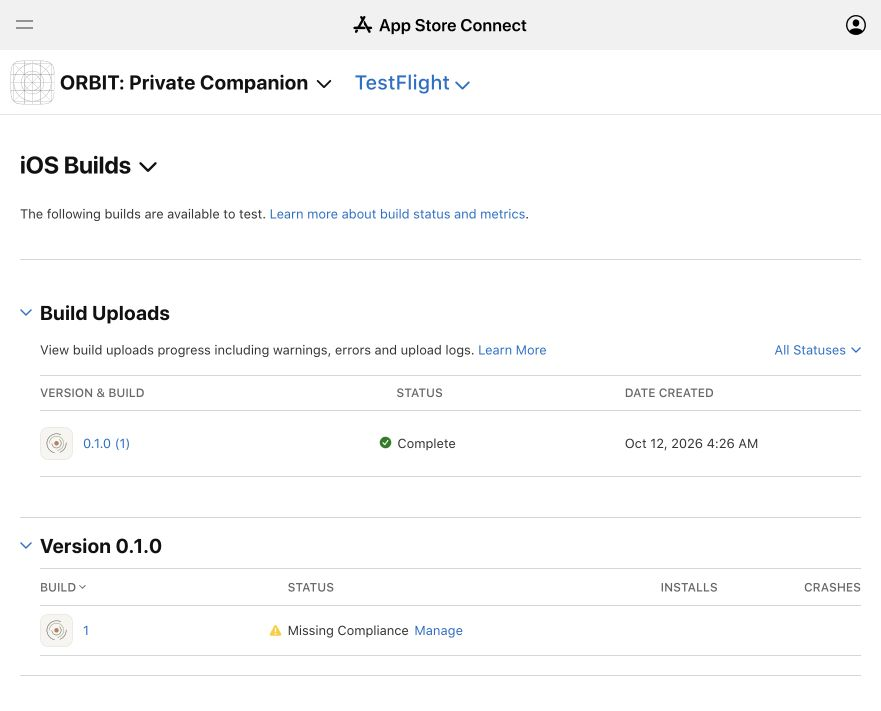

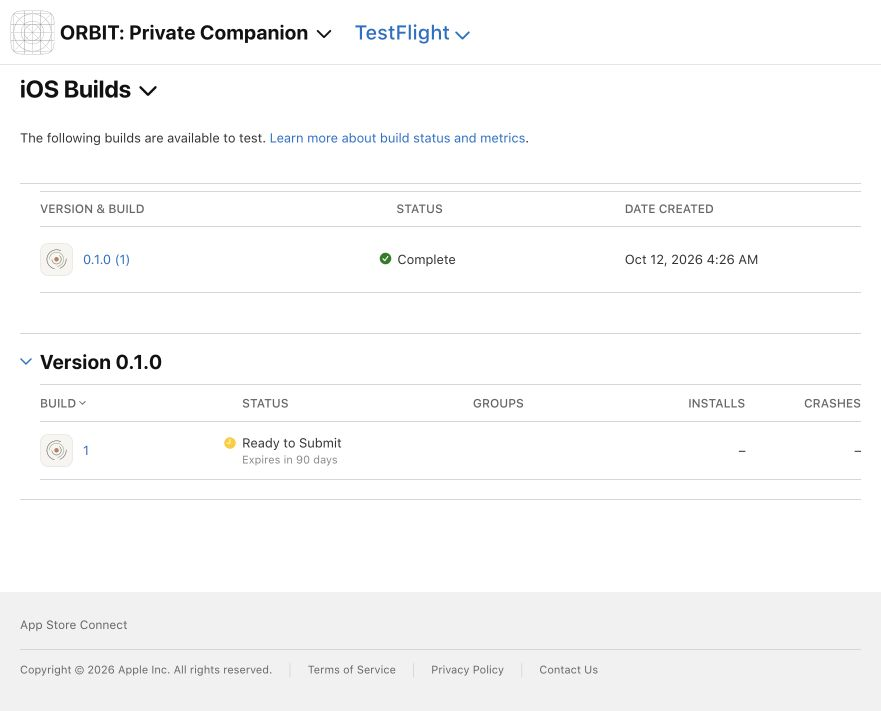

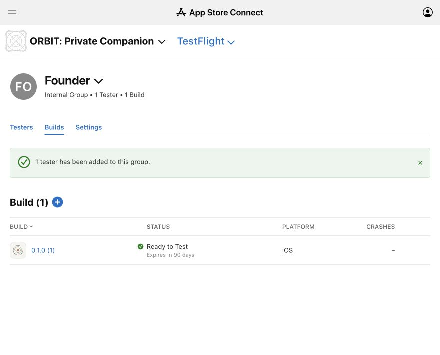

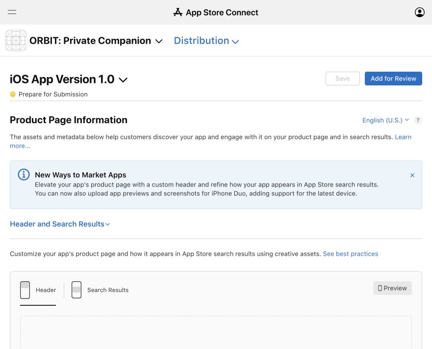

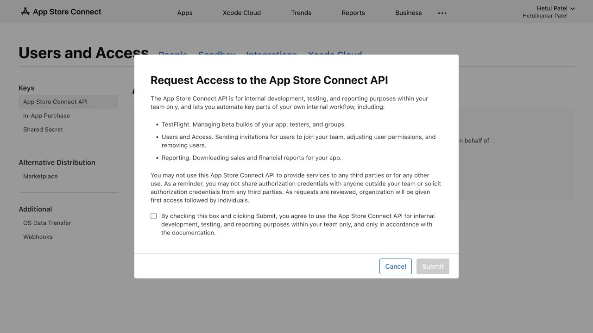

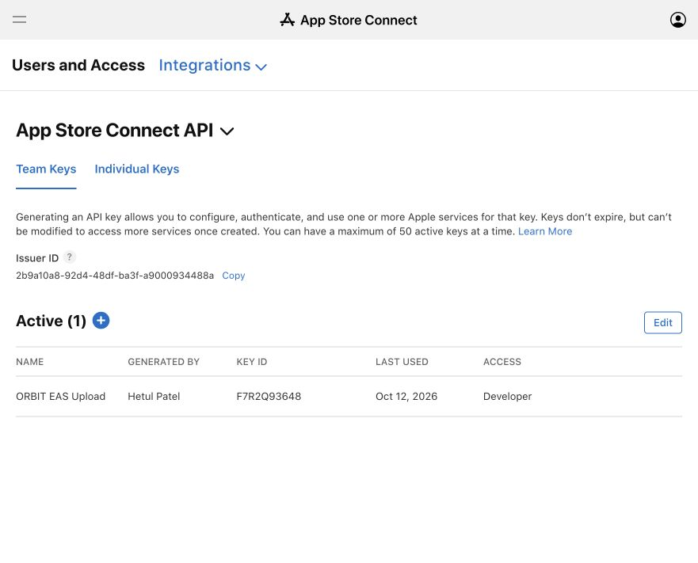

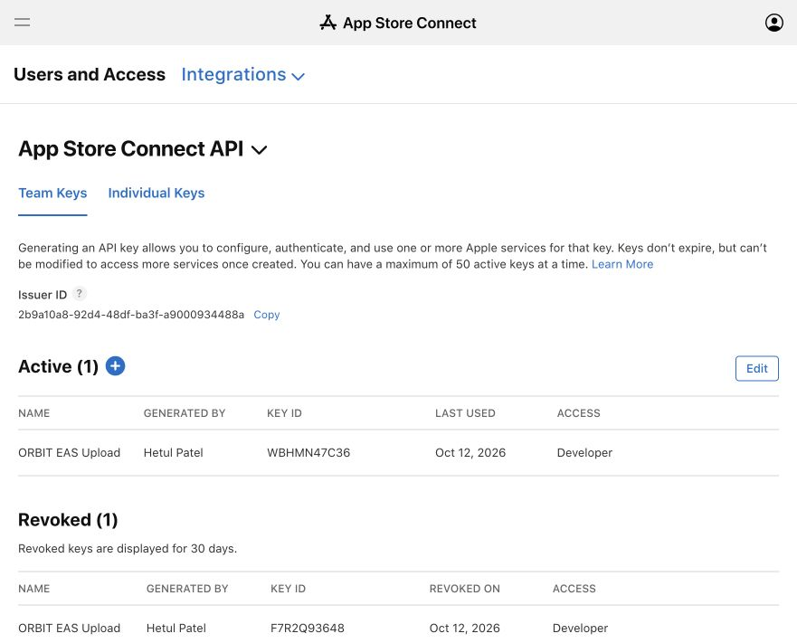

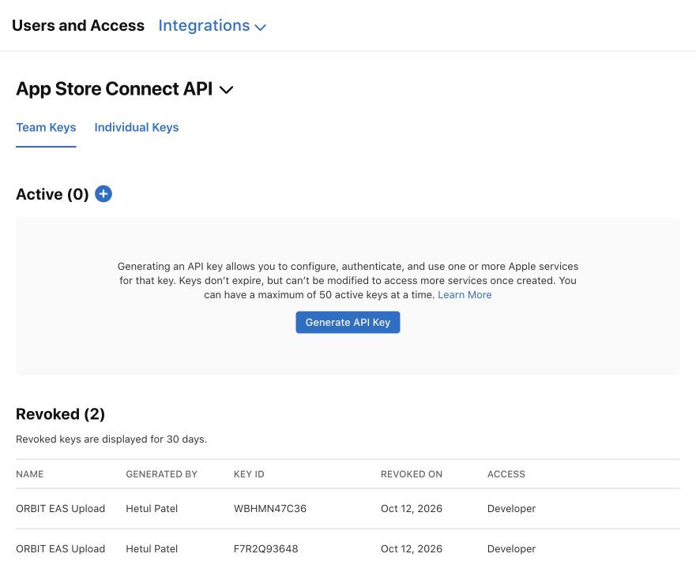

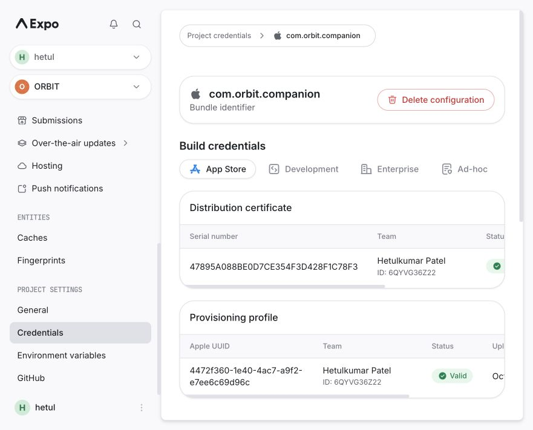

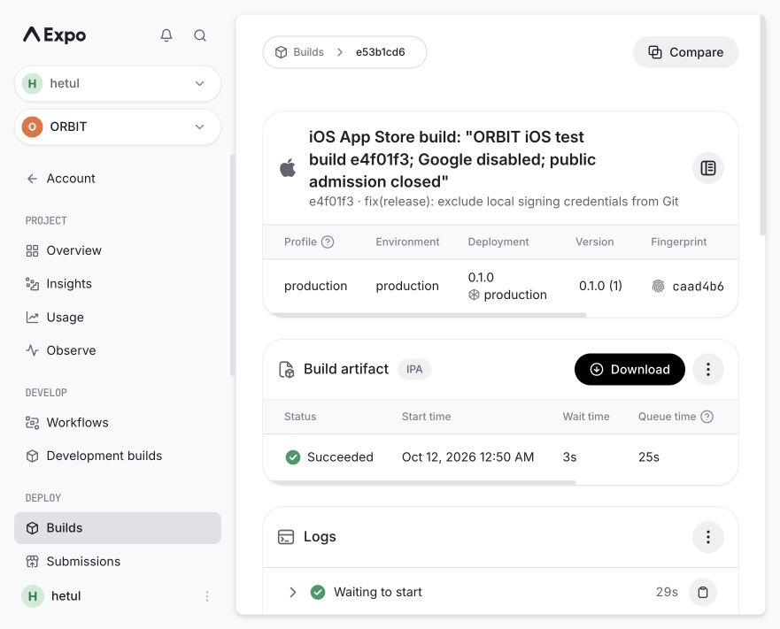

### Verified first-launch failure and iOS-only corrective update

The founder reports installing from TestFlight, tapping ORBIT and seeing the app close with a crash message before sign-in. Apple records **0.1.0 (1) / Crashed at 04:46 Chicago**. The downloaded crash archive is retained privately, ignored and mode 0600; it contains tester/device telemetry and was not committed or published. Its EXC_CRASH/SIGABRT backtrace passes through StartupProcedure.throwException and ErrorRecovery.crash/tryRelaunchFromCache. That stack alone does not name the underlying JavaScript error. Expo documents that iOS recovery stacks often originate in JS while Apple's report omits its message; [error-recovery explanation](https://docs.expo.dev/eas-update/error-recovery/).

The founder connected/unlocked the iPhone himself and reproduced the failure while macOS Console was filtered to **Process: ORBIT**, not all device/Mac logs. The captured exception is **TypeError: Cannot read property 'hostname' of undefined**. Native startup defines window without a browser Location object; apps/mobile/src/api.ts incorrectly read window.location.hostname during module import, before the root layout's Sentry.init executes. The absence of a new mobile Sentry issue was not treated as absence of a crash. Capture was paused after diagnosis and resumed only for the corrective retest; no scrubber, IP protection, performance sampling or provider permissions were relaxed.

Commit **1b6a1b769f35037eb789a46e35bf11360b161319** limits the hostname lookup to Platform.OS === 'web'. Five real-API-module startup regressions cover iOS/Android window-without-location, a native location getter that must never be touched, existing web hostname behavior, and explicit production configuration without window. Before the repair, three fail with the same native error; after it, five pass. All **54 mobile tests** and **22 root-script tests** pass, zero failures/skips; mobile typecheck/lint and formatting pass. This does not rerun the full isolated API/worker suite or replace native verification. A search of app/src/UI sources finds no other window/document/navigator property accesses outside this guarded path.

An actual production iOS/Hermes export was generated separately from the web output with root dotenv autoload disabled and only approved public mobile configuration provided. Bundle size **5,189,936 bytes**, SHA-256 **c46fa20e41ea4e7e401997438a3e398e36ce9a9af4eb861e96bd3ab1d01f5acb**; source map has 2,434 sources and debug ID **ad42cb2c-36c5-4da7-a545-cc387b843aae**. The map includes the native guard; packaged HTTPS/WSS endpoints match production. All 44 exported files were checked against actual private root/provider/production env values with no matches. This is a targeted export check, not a formal whole-runtime audit. The matching source map uploaded successfully to only Sentry orbit-mobile (artifact bundle f744b2b1-d449-5665-81c1-3867d7d67ae5); actual native symbolication remains unverified until a matching event arrives.

Existing channel **production** is Active, mapped to branch production with no earlier remote updates; inspected IPA Expo.plist confirms project 55cd03c0-0e65-486b-b0af-6ce7904edde1, channel production, runtime 0.1.0 and launch check ALWAYS. [Published iOS-only update d7521cef](https://expo.dev/accounts/hetul/projects/orbit/updates/d7521cef-54a1-4094-94fd-a38d6f824a4f) uses source commit 1b6a1b7, runtime 0.1.0 and update ID **01a12f91-d85a-700c-8031-ca0105c04183**. EAS confirms one matching iOS build, bundle/source-map uploaded and existing assets reused. The commit display has an asterisk because the documentation/evidence worktree remained dirty; the inspected exported API source contains the committed fix. No native dependency, entitlement, credential, legal declaration, Android channel, public admission gate or paid plan was changed. No automatic public App Review submission occurred.

An independent native-protocol fetch verifies that the existing iOS channel/runtime serves exact update 01a12f91-d85a-700c-8031-ca0105c04183: manifest **HTTP 200**, launch asset **HTTP 200**, 5,189,936 bytes and SHA-256 matching the inspected export above. Initial diagnostic requests omitted multipart acceptance and the manifest-provided per-asset headers, producing 406/403; those were corrected in the test harness following the installed expo-updates implementation, without copying a browser cookie/account token or changing any protection. The actual native implementation already uses those protocol headers. Server delivery is not proof of successful execution on the founder's phone.

The founder was asked to stay connected/online, open ORBIT long enough to download, force-close and reopen, with at most one additional retry if the first launch still crashes. No corrective phone-retest result has been received at this checkpoint; Console streaming is paused rather than left capturing indefinitely. Publication is not proof that the phone downloaded or successfully launched the correction. A new native IPA/APK embedding the fix remains necessary for fresh installs that cannot download an update; the original artifacts must not be published as a working public release.

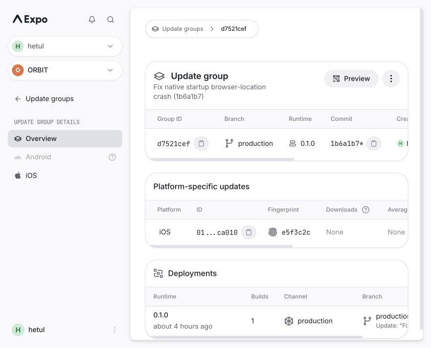

Android signing/build was explicitly approved. New remote ORBIT keystore created; version 0.1.0/code 1 and preview update channel initialized. [Actual EAS build fe1c8591](https://expo.dev/accounts/hetul/projects/orbit/builds/fe1c8591-42af-4762-8866-06228a93c0ac) uses commit 8971c2d6de357aece60a794da65ed20a4cfad439 and **FINISHED successfully** at October 11, 11:49:27 PM Chicago time. Native build time 21m19s. APK saved locally at artifacts/android/ORBIT-0.1.0-1.apk, outside Git/EAS uploads. Build page showed 13 days availability; its temporary artifact link was not published as a permanent landing download.

Artifact inspection with Google's official apksig 9.4.1 verifies its v2 cryptographic signature with zero warnings. Package com.orbit.companion, version 0.1.0/code 1, minimum Android API 24, target 36, debuggable false; microphone permission absent, notification permission present. Actual packaged JavaScript contains the deployed HTTPS API and WSS stream URLs; no actual private root/provider/production env values were found in that checked bundle. This is **artifact inspection, not physical installation or feature/device testing**. Founder-only operator bootstrap is now explicitly approved/live, as detailed below; actual founder production registration remains unverified and public admission is still closed.

- APK SHA-256: da46aca5ea85e94052814d789a4af90b88058f6cb2adad234854c384b26c3c45.
- Signer certificate SHA-256: ca73d20caf8dfd97357fdb4ed97cc98a787442973a0f9bb5ce080ee6e2b15211.

Before Play distribution, settle signing-identity continuity for existing APK testers and independently inspect the final AAB/Play-delivered build. No private keystore transfer to Google or Play App Signing enrollment occurred in this follow-up. Retain the current EAS signing record; do not rotate it to solve unrelated provider issues.

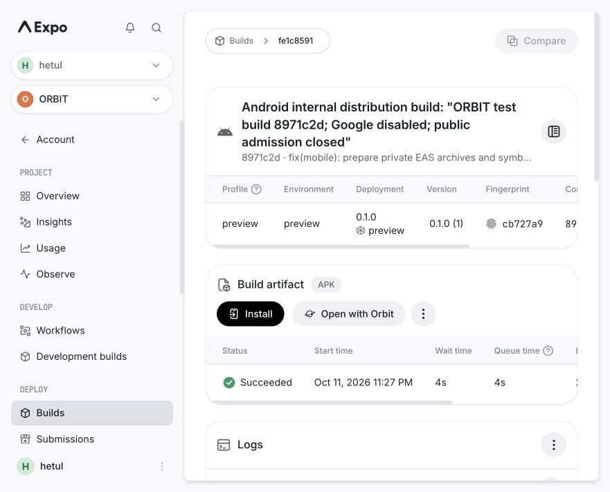

Build preparation repaired three real gaps: root .easignore excludes private env/signing/local evidence files; EAS post-install builds the shared workspace dependency; Metro now adds Sentry debug IDs with replay/development source-context endpoint disabled. Archive inspection succeeded after a transient api.expo.dev DNS failure; private env files/docs/signing artifacts were absent. No DNS override or paid workaround. Local Android native JavaScript/Hermes export succeeded; source map has a debug ID and 2,485 embedded sources, no actual private env values in the checked map. That export is not an installed APK and used local export settings, not a deployed-device session.

## Latest tests and remaining gates

October 12 04:29 Chicago follow-up: all **22 root-script configuration tests pass**, zero failures/skips, including the three targeted EAS build/submission tests. These are local configuration/fixture tests; no production data or paid model evaluation was used. Local /agent returns HTTP 200; deployed /ready returns HTTP 200/database ready and alpha status reports capacity 100, admission false, waitlist true and reason safety_coverage. The earlier full-suite result below is the last full isolated run, not a claim that all application tests were rerun during this follow-up.

Founder confirmed ORBIT is personally owned, not a registered organization, and completed personal Play registration himself. The dashboard is now accessible under his chosen developer profile **Aegisure**. It explicitly says identity review is pending, Android device verification is action-required and phone verification must wait for identity approval. **Create app is disabled** until account checks clear. No agent purchased registration, accepted its agreement, uploaded identity documents or guessed legal information; payment receipt was not inspected. New registration costs $25 once. New personal accounts additionally require a closed test with at least 12 continuously opted-in testers for 14 days, then production-access application; direct APK/internal testing does not satisfy that requirement. [Registration](https://support.google.com/googleplay/android-developer/answer/6112435), [personal-account testing](https://support.google.com/googleplay/android-developer/answer/14151465).

Founder subsequently confirms identity documents are submitted and **under review**, not approved, and that he has only Apple devices. The current device-verification detail page still requires the account owner to use the Play Console Android app and his own Google account, then select Aegisure. Google's official instructions allow any non-rooted physical Android mobile device running **Android 10 or newer**, including one used to verify other accounts; it need not share the signup phone number or be retained for future checks. Therefore a trusted borrowed qualifying phone is a legitimate route, using the founder's own account and signing out afterward. An iPhone or emulator does not meet this physical-device requirement. No device purchase, borrowed developer account or fake verification was attempted. Identity review, Android device verification and phone verification are separate gates. [Device requirements](https://support.google.com/googleplay/android-developer/answer/14316361?hl=en).

Founder explicitly approved production operator bootstrap for patelhetul803@gmail.com, with moderation-report/suspension authority disclosed. Only orbit-api's ADMIN_EMAILS was changed; the reviewed Railway patch contained exactly one variable change and no destructive, shared-variable or networking changes. Deployment **6670edae-09a0-41be-8110-1f356d96d010** is SUCCESS, with one running replica and no pending work. It built e4f01f3 from main, rather than reusing the old 92d8199 image; a source diff verifies API/worker/packages/infra/Dockerfile are unchanged between those commits. Readiness returns 200/database ready; /v1/alpha/status still reports acceptingNewAccounts false, capacity 100, reason safety_coverage. PUBLIC_ALPHA_SIGNUPS_OPEN and MODERATION_COVERAGE_CONFIRMED stay false. This approval is not staffing coverage, a general signup exemption or evidence of an authenticated production account; real founder OTP/sign-in and operator-role response remain unverified. Local UI at localhost:8081/agent also returns 200 and remains on the local backend, not this production account. No production data was wiped/seeded. Localhost browser CORS is rejected by production; it was not widened to create a test shortcut.

Last full isolated suite before the native repair: **150 passing, zero failures/skips** (129 Vitest plus 21 root-script tests). Databases orbit_test_mobile_isolated_20261011 and orbit_test_mobile_alpha_isolated_20261011 were newly created/migrated; only the former received synthetic seed data. Primary and production data were not wiped/reseeded. One intermediate run inherited local real Google configuration and failed an expected-unconfigured assertion; the final runner excludes private root-env fields, uses fresh test databases and keeps the assertion unchanged. The repair follow-up separately reruns 54 mobile and 22 root tests, not a new full API/worker suite. Mobile typecheck/lint, actual shared hook, archive inspection and local native JS export pass.

Remaining: successful corrected iPhone launch/sign-in, native IPA/APK rebuilds embedding the repair and actual Android install, native Sentry/push, real production founder OTP/role proof, real Google grant/sync/Catch sources, two-device reveal, outage/offline/cost/delete/export matrix, real moderated response/staffing, backups/least privilege/ingress, advisories/hosted CI, reviewer account, native store assets/disclosures/external deletion page and Google verification. The latest [CI on e4f01f3](https://github.com/Hetul803/ORBIT/actions/runs/38209611960) is failed before execution: GitHub's annotation says the account is locked due to billing. Local checks are not hosted green CI; no billing change was made. $100/month allocation excludes unapproved assessment/legal/staffing purchases; no paid EAS plan bought. [Full product report](PUBLIC_ALPHA_VERIFICATION.md), [provider evidence](PROVIDER_SETUP_VERIFICATION.md), [budget](BUDGETED_DEPLOYMENT.md), [distribution paths](LAUNCH_CHECKLIST.md).
